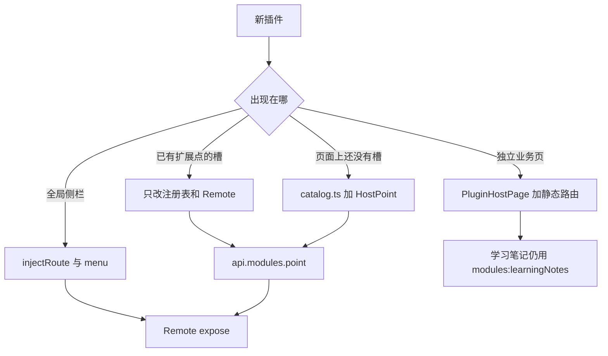

# 新插件接入指南（Host 侧）

> 面向要在主项目里挂载 Module Federation Remote 插件的开发者。  
> 业务代码只从 `@/federation` 导入。Remote 独立构建，本地默认 `http://127.0.0.1:9008/mf-manifest.json`。

页面内嵌插件的逐步文件、逐行代码和验收画面见 [`access.md`](./access.md)。本文负责选定形态，并说明每种形态要改哪些文件。

---

## 0. 先选接入形态

| 形态 | 插件出现在哪 | 主项目要改什么 | 插件拿到的模块 |
|------|----------------|----------------|----------------|
| **A. 已登记扩展点** | 单词卡、词库、错题、收藏、复习、每日阅读、阅读页等已经登记的槽 | 通常不改代码。注册表写 `host.surface`、`host.slot`、`modules:point` | `api.modules.point` |
| **B. 新的扩展点** | 某个页面上还没有可挂的槽 | `points/catalog.ts` + 该页面放 `HostPoint`（阅读页这类自己画按钮的，继续用 `PluginHostSurface`） | `api.modules.point` |
| **C. 业务页整页内嵌** | 学习笔记这种独立页面，含 Popout、跨窗同步 | 静态路由 + `<PluginHostPage pluginId="…" />`。专属能力仍走 `modules/learningNotes` | `api.modules.learningNotes` |
| **D. 顶层独立路由** | 插件自己占侧栏一项，例如视频播放器 | 注册表 `injectRoute: true` + `menu`。不必手写路由 | 按它声明的 permissions |



聊天只暴露 `modules:chat` 的 `openThread`。新的页面内嵌插件不要再仿照它新建 `modules/<pluginId>`。

已发布、只声明 `modules:ebook`、`modules:vocabDetail`、`modules:vocabDetailImport` 的包加载不到模块。改成 `modules:point` 后重新发布。`hostApiRange` 仍是 `^1.0.0`。

---

## 1. `federation/` 里什么时候改

| 目录 / 文件 | 职责 | 新插件要不要改 |
|-------------|------|----------------|
| [`points/catalog.ts`](./points/catalog.ts) | 点、槽、上下文键、信号、命令 | **新槽位要改**。挂已有槽不改 |
| [`points/api.ts`](./points/api.ts) | 按目录冻结 `api.modules.point` | 不改 |
| [`points/session.ts`](./points/session.ts) | 槽会话、上下文、信号、命令表 | 不改 |
| [`points/commands.ts`](./points/commands.ts) | 不依赖某一页状态的命令：朗读、选 JSON、打开详解 | 只有这种命令才加 |
| [`host/HostPoint.tsx`](./host/HostPoint.tsx) | 按目录画顶栏、行按钮、抽屉 | 不改。业务页放 `<HostPoint />` |
| [`host/PluginHostSurface.tsx`](./host/PluginHostSurface.tsx) | 页面自己画的触发器和抽屉，当前是阅读页和词库列表 | 不改组件。新页面若要自己画，直接使用 |
| [`host/PluginHostPage.tsx`](./host/PluginHostPage.tsx) | 整页或业务路由内嵌 | 不改 |
| [`runtime/index.ts`](./runtime/index.ts) | `buildModules`、iframe RPC | **不为新扩展点插件改**。`modules:point` 已按 `host.surface` 装配 |
| [`modules/`](./modules/README.md) | 学习笔记专属 API | 新扩展点插件不建子目录 |
| [`registry/`](./registry/README.md) | 拉 `plugins-registry.json` | 不改代码，改 JSON |
| [`enabled/`](./enabled/README.md) | 账号上架开关 | 不改 |
| [`index.ts`](./index.ts) | 业务侧唯一出口 | 不改，除非业务页要新的已有符号 |

`buildModules` 看到 `modules:point` 时，用该插件的 `host.surface` 查目录。对得上才挂上 `modules.point`。`surface` 写错时，插件没有这个对象。

---

## 2. 按形态勾选

### 形态 A：挂到已有点

| 步骤 | 位置 | 动作 |
|------|------|------|
| 1 | Remote | expose 组件，用 `api.modules.point` 读上下文和载荷 |
| 2 | 注册表 | `host.surface` = 点 id，`host.slot` = 槽名，`permissions` 含 `modules:point`，`injectRoute: false` |
| 3 | 插件中心 | 重新拉取注册表并启用 |

已有点和槽见 [`access.md` 第 2 节](./access.md)。主项目源码不用改。

### 形态 B：新开一个点

| 步骤 | 位置 | 动作 |
|------|------|------|
| 1 | `points/catalog.ts` | `POINT` 与 `hostPoints` 增加一项 |
| 2 | 目标页面 | `usePointContext`、`<HostPoint>`；需要页内能力时 `bindPointCommand` |
| 3 | `router/routes.ts` | 页面若不在 `/english-learning` 下，要自己挂抽屉并在离开时 `closePoint` |
| 4 | Remote + 注册表 | 与形态 A 相同 |

逐文件代码和「点一次按钮之后发生什么」见 [`access.md` 第 10 节](./access.md)。英语学习里的普通抽屉由 [`Layout.tsx`](../views/englishLearning/Layout.tsx) 扫描 `layoutDrawerSlots` 挂上，不要为每个新抽屉改布局。

### 形态 C：学习笔记这类整页

| 步骤 | 位置 | 动作 |
|------|------|------|
| 1 | Remote | expose 整页组件 |
| 2 | 注册表 | `injectRoute: false`，`permissions` 含 `ui:toast`、`http:plugin-api`、`modules:learningNotes` |
| 3 | 业务页 | `usePluginEnabled` + `PluginHostPage` |
| 4 | `router/routes.ts` | 静态子路由，例如 `/english-learning/notes` |

不要把这条路径套到单词卡、阅读页或新的列表页上。

### 形态 D：顶层路由

注册表 `injectRoute: true`（缺省就是 true）并写 `menu`。`mf.start()` 之后路由注入器会加上该路由，`router/index.tsx` 已订阅 `mf.onRoutesChange`。不必在 `routes.ts` 再写一遍。

---

## 3. Remote

入口是 default export 的 React 组件，宿主把桥放在 `props.api` 上。样式在入口文件顶部 `import '@/styles.css'`，Host 不会执行 Remote 的 `main.ts`。

扩展点插件只使用 `api.modules.point` 的五个方法。点 id 不在参数里，由注册表 `host.surface` 固定。

```ts
const point = props.api.modules?.point;

const ctx = point?.getContext();
const row = point?.getPayload('drawer');
const off = point?.subscribe(() => {
  // 上下文变了，或这个点任意槽开关了。publishSignal 不会进这里
});
point?.command('markDone', rowId);
point?.command('closeIdeasList', undefined);
```

| 方法 | 作用 |
|------|------|
| `getContext()` | 页面用 `usePointContext` / `publishPointContext` 发布的对象。只含目录 `contextKeys`。离开页面或键是空串时为 `null` |
| `getPayload(slot)` | 该抽屉槽上的点击载荷。按钮插件读 `opens` 指向的槽，例如行按钮读 `'drawer'`，不要读 `'item-action'` |
| `subscribe(listener)` | 返回退订函数 |
| `publishSignal(name, value)` | 只接受该点 `signals` 里的 `pending` 或 `stats`。其它名字被丢掉 |
| `command(name, arg)` | 第二个参数必须传。名字不在目录里抛 `UNKNOWN_POINT_COMMAND`。页面还没绑定或已经卸载抛 `POINT_COMMAND_UNBOUND` |

`vite.config.ts` 的 `exposes` 键要和注册表 `expose` 一致，例如 `'./PracticeNote': './src/views/practice-note/index.tsx'`。

---

## 4. 注册表

开发清单在 `apps/backend/uploads/remotes/plugins-registry.json`。保存后到插件中心重新拉取。仍是旧数据时清掉 `dnhyxc.plugin.registry.dev.v1`。

### 4.1 扩展点插件

```json
{
  "id": "practiceNote",
  "title": { "zh-CN": "练习笔记", "en-US": "Practice note" },
  "routePath": "/plugins/practice-note",
  "entry": "http://127.0.0.1:9008/mf-manifest.json",
  "expose": "./PracticeNote",
  "remoteName": "dnhyxc-ai-practice-note",
  "version": "0.0.1",
  "hostApiRange": "^1.0.0",
  "injectRoute": false,
  "host": {
    "surface": "english.practice",
    "slot": "item-action",
    "icon": "notebook"
  },
  "permissions": ["modules:point"],
  "enabled": false,
  "trust": "first-party"
}
```

`host.surface` 等于 `points/catalog.ts` 里的点 id。`host.slot` 等于该点某个槽的 `name`。

- 行按钮、卡片按钮：`slot` 写按钮槽（`item-action`、`card-action`、`library-card-action`）。`HostPoint` 画按钮，并把同一个插件画进 `opens` 指向的抽屉。
- 顶栏：`slot` 写 `toolbar`。
- 页面自己打开的抽屉（阅读页、词库列表）：`slot` 写那个抽屉槽，例如 `drawer`。

`remoteName` 不写时用 `id`。同一份 manifest 里的多个插件要写成不同的远程名。`expose` 缺省是 `./App`。`injectRoute: false` 避免再注入一条顶层路由。

单词详解这类还要请求后端的插件，在 `permissions` 里加上 `http:plugin-api` 和 `ui:toast`。这三项和 `modules:point` 同时存在。

### 4.2 整页内嵌

`injectRoute: false`，不写 `host`。`id` 与 `<PluginHostPage pluginId="…" />` 一致。学习笔记的 permissions 是 `ui:toast`、`http:plugin-api`、`modules:learningNotes`。

### 4.3 顶层路由

```json
"injectRoute": true,
"menu": { "order": 50, "icon": "https://…/icon.svg" }
```

---

## 5. 主项目页面怎么挂

### 5.1 已有扩展点

页面上已经有对应的 `HostPoint` 或 `PluginHostSurface`。新插件只改注册表。例如每日阅读的顶栏和行按钮：

```tsx
<HostPoint pointId={POINT.dailyReading} slot="toolbar" />
<HostPoint
  pointId={POINT.dailyReading}
  slot="item-action"
  payload={{ id: item.id, titleEn: item.titleEn, publishDate: item.publishDate, origin }}
/>
```

行插件的 `host.slot` 写 `item-action`，组件里 `getPayload('drawer')`。

### 5.2 新扩展点

目录用 `listPoint(id, contextKeys)` 生成顶栏、行按钮和抽屉。第二个参数是上下文键名，不是每个点都写 `kind`。然后在页面发布上下文并放上入口：

```tsx
usePointContext(POINT.practice, { kind });

<HostPoint pointId={POINT.practice} slot="toolbar" />
<HostPoint
  pointId={POINT.practice}
  slot="item-action"
  payload={{ id: item.id, title: item.title }}
/>
```

页面要给插件调用的能力，在 effect 里绑定，卸载时解绑：

```tsx
useEffect(() => {
  return bindPointCommand(POINT.practice, 'markDone', (arg) => {
    const id = typeof arg === 'string' ? arg.trim() : '';
    if (!id) return false;
    return true;
  });
}, []);
```

命令名必须先写进该点的 `commands`。不依赖页面 state 的命令写在 `points/commands.ts`，应用启动时注册一次，现成的有词卡 `play` / `stop` 和词库 `pickJsonFile` / `openCard`。

新页面若挂在 `/english-learning` 的子路由上，普通抽屉不用自己画。阅读页不在这个布局里，抽屉标了 `layout.page: true`，按钮和抽屉仍是 `PluginHostSurface`，上下文和命令在 `views/ebook/read.tsx` 里发布：

```tsx
publishPointContext(POINT.ebookRead, { bookId, bookTitle });
bindPointCommand(POINT.ebookRead, 'navigateToCfi', (cfi) => { /* 滚到这个 CFI */ });
bindPointCommand(POINT.ebookRead, 'openThought', (thought) => { /* 打开想法 */ });
bindPointCommand(POINT.ebookRead, 'closeIdeasList', () => { /* 关掉当前插件抽屉 */ });
```

PDF 或离开页面时 `publishPointContext(POINT.ebookRead, null)` 并解绑。插件侧仍然调用 `api.modules.point`，不再有 `api.modules.ebook`。

### 5.3 整页内嵌

```tsx
const enabled = usePluginEnabled('learningNotes');
const [prefsReady, setPrefsReady] = useState(false);

useEffect(() => {
  let cancelled = false;
  void ensurePluginEnabledPrefsLoaded().finally(() => {
    if (!cancelled) setPrefsReady(true);
  });
  return () => {
    cancelled = true;
  };
}, []);
```

偏好还没加载完时 `usePluginEnabled` 是 false。等 `prefsReady` 再判断，避免误显示「已下架」。然后渲染 `<PluginHostPage pluginId="learningNotes" className="h-full min-h-0" />`。

### 5.4 应用启动

[`router/index.tsx`](../router/index.tsx) 已经 `mf.start()`、`mf.onRoutesChange` 和 `mf.setNavigate`。新插件不用改这个文件。

---

## 6. 专属模块还剩哪些

`runtime/index.ts` 的 `buildModules` 现在只有三条：

| permission | 挂上的 API | 用途 |
|------------|------------|------|
| `modules:point` | `api.modules.point` | 所有扩展点插件 |
| `modules:learningNotes` | `api.modules.learningNotes` | 笔记上下文、Popout、关窗保存、跨窗 sync |
| `modules:chat` | `api.modules.openThread` | 只打开一个会话 |

学习笔记的跨窗同步仍在 `modules/learningNotes/syncBus.ts`，复用 `sync/hostSyncBus.ts`。新扩展点插件不要为了读页面数据再加一套 `setXxxHostHandlers`。

---

## 7. 权限

| permission | 插件可用 |
|------------|----------|
| （无） | `api.theme`、`api.locale`、`api.event` |
| `ui:toast` | `api.ui.showToast`、全屏、选文件、下载 |
| `nav:subtree` | `api.navigate`，不能超出 `routePath` |
| `http:plugin-api` | `api.http.get/post/put/delete`，走主项目的 fetch |
| `modules:point` | `api.modules.point` 五个方法 |
| `modules:learningNotes` | `api.modules.learningNotes` |
| `modules:chat` | `api.modules.openThread` |

`modules:ebook`、`modules:vocabDetail`、`modules:vocabDetailImport` 已经不再装配。

---

## 8. 阅读页 iframe

不可信 iframe 的插件如果 `host.surface` 是 `ebook.read` 且带 `modules:point`，主项目仍接受原来的 RPC 名字，并转到该插件自己的 `api.modules.point`：

| RPC | 转到 |
|-----|------|
| `ebook.getBookId` / `ebook.getBookTitle` | `getContext()` 的对应字段 |
| `ebook.navigateToCfi` | `command('navigateToCfi', cfi)` |
| `ebook.openThought` | `command('openThought', thought)` |
| `ebook.closeIdeasList` | `command('closeIdeasList', undefined)`。未绑定时返回 `null` |

页面内的可信插件直接调 `api.modules.point`，不走这些 RPC 名字。

---

## 9. 验收

- [ ] Remote 的 `mf-manifest.json` 能打开，CORS 放行主站源和 `tauri://localhost`
- [ ] `expose`、`remoteName` 与 vite `exposes` 一致
- [ ] `hostApiRange` 为 `^1.0.0`
- [ ] 扩展点插件的 `host.surface`、`host.slot` 能在 `points/catalog.ts` 里对上
- [ ] `permissions` 含 `modules:point`；用了 toast 或后端再加对应权限
- [ ] 按钮插件的 `host.slot` 是按钮槽，组件读的是 `opens` 指向的抽屉槽
- [ ] 新页面在英语学习布局下时，没有再手写一个重复抽屉
- [ ] 页面级命令在卸载时解绑
- [ ] 插件中心启用后，未启用时入口不占位

运行时：

1. 打开宿主页，插件从 loading 到内容出现。
2. 控制台没有 manifest、权限或 `hostApiRange` 错误。
3. 扩展点插件能读到当前上下文；点击行按钮后 `getPayload` 是这一行。
4. 下架后入口消失。整页插件显示 `plugins.host.delisted`。
5. 未知命令是 `UNKNOWN_POINT_COMMAND`，页面已离开是 `POINT_COMMAND_UNBOUND`。

生产把 `entry` 换成发布后的 manifest，并用管理端保存注册表。账号开关见 [`enabled/README.md`](./enabled/README.md)。

---

## 10. 常见问题

| 现象 | 原因 |
|------|------|
| 行上没有按钮 | `host.slot` 写成了抽屉槽。`HostPoint` 只在按钮槽上找插件 |
| 有按钮，抽屉是空的 | 插件读了按钮槽名。载荷在 `opens` 指向的槽上，错题和每日阅读是 `drawer`，词库行是 `item-drawer` |
| `api.modules.point` 是 `undefined` | 没有 `modules:point`，或 `host.surface` 不在目录里 |
| `getContext()` 一直是 `null` | 页面没有 `usePointContext`，键不在 `contextKeys` 里，或值是空串 |
| `UNKNOWN_POINT_COMMAND` | 目录 `commands` 没有这个名字 |
| `POINT_COMMAND_UNBOUND` | 名字合法，但页面 effect 还没绑定或已经清理 |
| 顶栏数字不变 | 该点 `signals` 没有 `stats`，或 `total` / `loaded` 不是有限数字 |
| 刷新后 404 | `injectRoute: false` 时必须有静态路由。扩展点插件挂在已有页面上，不需要自己的业务路由 |
| 改了注册表仍是旧插件 | 清 `dnhyxc.plugin.registry.dev.v1` 后重新拉取 |
| 误显示已下架 | 整页插件要等 `ensurePluginEnabledPrefsLoaded` 完成再读 `usePluginEnabled` |

---

## 11. 相关文档

| 文档 | 内容 |
|------|------|
| [`access.md`](./access.md) | 扩展点参数、从零示例、逐步代码 |
| [`README.md`](./README.md) | `federation/` 目录索引 |
| [`points/catalog.ts`](./points/catalog.ts) | 当前全部点和槽 |
| [`modules/README.md`](./modules/README.md) | 学习笔记专属模块；扩展点不要往这里加 |
| [`packages/federation-kit/docs/plugin-guide/`](../../../../packages/federation-kit/docs/plugin-guide/) | Remote 桥、权限、样式隔离 |
