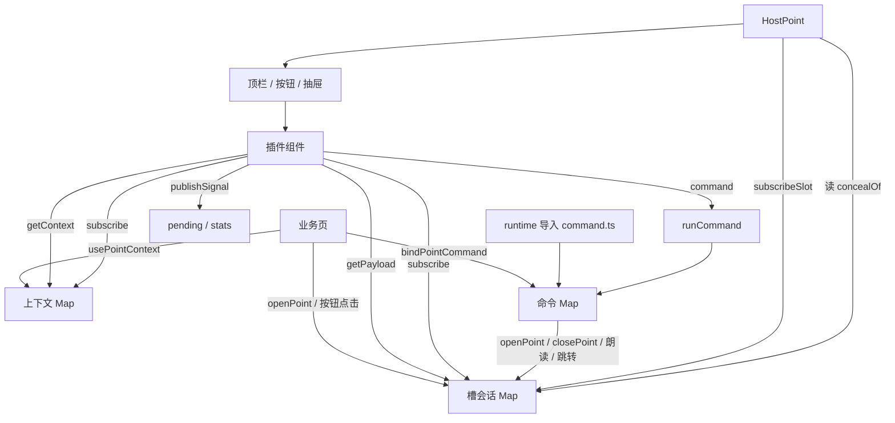

# 插件系统维护手册

> **一句话**：主项目事先登记一批扩展点，页面把上下文和打开载荷放进内存会话，插件通过 `api.modules.point` 读取，并调用主项目已经绑定好的命令。  
> **入口**：英语学习各列表页、单词卡、每日阅读文章页、电子书阅读页；插件中心启用后，按钮、顶栏或抽屉里出现插件。  
> **关联文件**：`points/catalog.ts`、`points/session.ts`、`points/api.ts`、`points/command.ts`、`host/HostPoint.tsx`、`host/PluginHostPage.tsx`、`runtime/index.ts`。  
> **文档目标**：维护者能说清数据怎么走、主项目提供哪些方法、页面有哪几种画法，以及改需求、做优化、查 bug 先打开哪个文件。  
> **非目标**：不写 Module Federation 打包、注册表 COS 拉取、学习笔记专属 `modules.learningNotes` 的内部实现。那些分别见 `registry/README.md`、`modules/learningNotes/`。新插件选哪种形态见 [`guide.md`](./guide.md)，逐步接入见 [`access.md`](./access.md)。

---

## 0. 先看这里

### 0.1 30 秒读懂

- **做什么**：页面负责「现在是哪本书、哪个词库、打开了哪个词」。插件负责自己的界面。主项目负责把两者接上，并代插件做朗读、跳转、选文件这类必须留在主项目里的事。
- **不做什么**：插件不能自己造槽、不能自己造命令名、不能把抽屉开关写进页面的 React state。注册表里一个插件描述只声明一个 `host.surface` 和一个 `host.slot`。
- **关键角色**：`catalog.ts` 决定这个点允许什么；`session.ts` 记住当前数据；`HostPoint` 把槽画出来；`command.ts` 和个别页面把命令实现挂上；`runtime/index.ts` 在插件加载时把 `api.modules.point` 塞进桥。

### 0.2 功能点总表

| 编号 | 功能点（人话） | 用户可感知表现 | 关键实现位置 | 正文小节 |
|------|----------------|----------------|--------------|----------|
| F1 | 应用启动时把不依赖某一页的命令挂上，插件加载时只拿到自己那个点的五个方法 | 插件能读上下文、读载荷、订阅、回写信号、调命令 | `runtime/index.ts` → `buildModules`；`points/api.ts` → `createPointApi` | §4.1 |
| F2 | 作者用四种角色描述一个点，编译成槽 | 页面上出现顶栏、按钮或抽屉；纯命令点什么都不画 | `points/catalog.ts` → `compilePoint`、`pointDefs` | §4.2 |
| F3 | 页面把当前库、书、来源交给插件；插件读到的是副本 | 换词库后插件列表跟着变；离开页面后读到 `null` | `usePointContext` → `publishPointContext` → `getContext` | §4.3 |
| F4 | 打开抽屉时把词或记录先写入槽，插件可以还没下载完 | 点按钮后抽屉出现，插件随后读到 `getPayload` | `session.ts` → `openPoint` / `closePoint` | §4.4 |
| F5 | 列表盖住详解，详解露出来时列表和导入只藏起来 | 两层抽屉不会叠着滑；被盖住的详解仍算打开 | `catalog.ts` → `stacks`；`session.ts` → `concealOf` | §4.5 |
| F6 | 同一个 `HostPoint` 按槽种类画四种东西 | 顶栏内联、卡片按钮、阅读页图标、抽屉正文 | `host/HostPoint.tsx` | §4.6 |
| F7 | 命令分两处绑定：启动时一份，页面闭包一份 | 朗读不跟页面走；跳转和导出跟英语学习壳、阅读器走 | `points/command.ts`；`Layout.tsx`；`ebook/read.tsx` | §4.7 |
| F8 | 英语学习布局自动挂普通抽屉；页面自己的抽屉由页面挂 | 离开英语学习全部抽屉关掉；词库列表抽屉由词库页自己挂 | `Layout.tsx`；`layoutDrawerSlots` | §4.8 |
| F9 | 整页插件不走槽，走 `PluginHostPage` 或注册表注入路由 | 每日阅读单词页、侧栏独立插件整页出现 | `host/PluginHostPage.tsx`；描述符 `injectRoute` | §4.9 |
| F10 | 插件把「正在转圈」和「顶栏数字」写回主项目 | 词卡按钮转圈；词库抽屉标题显示已加载条数 | `publishSignal`；`HostPoint` 的 `isPointPending` | §4.10 |

### 0.3 架构一图



数据只有三条进插件、一条回主项目、一条调用主项目：

| 方向 | 名字 | 谁写 | 谁读 | 存在哪 | 什么时候没了 |
|------|------|------|------|--------|----------------|
| 页 → 插件 | 上下文 `context` | 页面 `usePointContext` / `publishPointContext` | `getContext()` | `contexts` Map，按点一份 | 页面离开、或没有任何有效键，变成 `null` |
| 页 → 插件 | 载荷 `payload` | `openPoint` | `getPayload(slot)` | `slots` Map，按「点 + 槽」一份 | `closePoint` 把 `payload` 置 `null` |
| 插件 → 页 | 信号 `signal` | `publishSignal` | 顶栏 `readStats`、按钮 `isPointPending` | `statsByPoint`、`pending` | 统计可被插件写成 `null`；转圈跟抽屉开关无关，关抽屉不清 |
| 插件 → 主项目 | 命令 `command` | 插件调用 | `runCommand` 找到已绑定函数 | `commands` Map | 页面绑定的命令在 effect 清理时解绑；启动绑定的一直在 |

### 0.4 文件地图与改动顺序

| 序 | 文件 | 职责 | 改它的时机 |
|----|------|------|------------|
| 1 | `points/catalog.ts` | 点 id、四种角色、上下文键、信号名、命令名、叠放表 | 新页面、新槽、新命令名、两层抽屉的盖住/让位 |
| 2 | `points/session.ts` | 唯一内存状态和叠放计算 | 修开关、覆盖、上下文裁剪、信号校验。不要为某一个插件加分支 |
| 3 | `points/api.ts` | 冻结五个方法 | 几乎不改。五个方法的名字是插件契约 |
| 4 | `points/command.ts` | 启动时绑定的命令 | 新命令不依赖某一页的 `navigate`、阅读器、文案 |
| 5 | `runtime/index.ts` | 按权限组装 `api.modules`，并副作用导入 `command.ts` | 新的权限模块才改 `buildModules`。新扩展点不改这里 |
| 6 | `host/HostPoint.tsx` | 四种画法 | 所有槽的外观、动画、滚动锁。不要为某一个插件复制一份组件 |
| 7 | `host/PluginHostPage.tsx` | 真正挂上 Remote 组件，处理加载和错误 | 整页壳、工具栏错误提示 |
| 8 | 业务页 | `usePointContext`、`HostPoint`、页面级 `bindPointCommand` | 这个页面要提供上下文、自己的按钮，或闭包命令 |
| 9 | 插件注册表 | `host.surface`、`host.slot`、`permissions`、`injectRoute` | 挂到已有槽。主项目源码不用动 |

业务代码只从 `@/federation` 导入。`points/command.ts` 里用 `isPluginEnabled` 时直接引 `@dnhyxc-ai/federation-kit`，不要引 `@/federation`，否则和 `runtime/index.ts` 互相导入。

---

## 1. 人话版：一次打开是怎么发生的

1. **应用起来**：`runtime/index.ts` 导入 `points/command.ts`。朗读、选 JSON、从文章打开详解、关掉阅读页想法列表，在这一刻挂上。此时还没有任何页面。
2. **用户打开词库**：词库页调用 `usePointContext`，把 `libraryId` 写入这个点。顶栏若有 `slot: "toolbar"` 的已启用插件，`HostPoint` 把插件画进顶栏。插件 `getContext()` 读到 `{ libraryId }`。
3. **用户点卡片上的插件按钮**：按钮槽是动作槽。`HostPoint` 调用 `openPoint`，把这个插件 id 和当前词写入它要打开的抽屉槽。布局里已经挂着的抽屉 `HostPoint` 订阅到这次变化，画出抽屉，里面再挂插件正文。插件 `getPayload("drawer")` 读到 `{ word, ... }`。
4. **插件要主项目做事**：例如朗读。插件调用 `command("play", word)`。主项目查这个点的命令表里有没有 `play`，再查有没有人绑定实现，然后播。插件不自己持有语音引擎。
5. **列表盖住详解**：词库列表抽屉打开时，叠放表把单词卡抽屉标成被盖住。详解的 `open` 仍是 true，只是这一帧透明、不接收点击、不播退场。列表关掉后详解在原处出现。
6. **离开**：离开英语学习时，布局卸载，把目录里每一个抽屉槽 `closePoint`。阅读页离开 EPUB 时，页面自己清上下文并关掉自己的抽屉。页面绑定的跳转命令一并解绑。

---

## 2. 问题与解决方案总表

| 编号 | 现象 / 风险 | 根因 | 本项目做法 | 功能点 |
|------|-------------|------|------------|--------|
| P1 | 插件包还在下载，点了按钮没有东西可画 | 载荷如果只放在插件内部，冷启动时丢失 | 载荷先写进槽会话，插件稍后 `getPayload` | F4 |
| P2 | 每个插件一套开关字段，页面互相不知道谁开着 | 抽屉状态散落在各页 `useState` | 开关只在 `SlotSession`。页面要开就 `openPoint` | F4、F8 |
| P3 | 列表和详解叠在一起，或详解被关掉后无法恢复 | 把「藏起来」做成了「关闭」 | `covered` / `concealOf` 只改可见性，不改 `open` | F5 |
| P4 | 插件读到别的页面的库 id，或读到页面没打算给的字段 | 上下文是一个大对象往下传 | 按点隔离，只保留该点 `contextKeys` 里的键 | F3 |
| P5 | 插件随便调用主项目内部函数 | 插件跑在独立包里，不能 import 主项目页面 | 闭集命令名 + `bindPointCommand`。未声明抛 `UNKNOWN_POINT_COMMAND`，没绑定抛 `POINT_COMMAND_UNBOUND` | F1、F7 |
| P6 | 同一个词上两个插件按钮一起转圈 | 进行中只按词记录 | 键是「点 + 插件 id + 词」 | F10 |
| P7 | 离开英语学习后抽屉还开着，或子页一切换词就丢了 | 清理时机绑错 | 布局只在卸载时关全部抽屉；子页切换不关。每日阅读文章页只关自己带 `scope: 'dailyReading'` 的那两个槽 | F8 |
| P8 | 为新插件复制一套 Host 组件 | 把「插件差异」写成了「页面差异」 | 差异只允许出现在角色、槽名、命令实现。画法全走 `HostPoint` | F2、F6 |

---

## 3. 实现思路总览

### 3.1 总体策略

一个扩展点是一张能力菜单，不是某一个插件的配置。菜单上只有四样东西：

| 角色 `kind` | 编译结果 | 谁把它画出来 |
|-------------|----------|----------------|
| `toolbar` | 槽名固定 `toolbar`，种类 `toolbar` | 页面放 `<HostPoint slot="toolbar" />`，每个已启用且 `host.slot === "toolbar"` 的插件内联一块 |
| `toggle` | 一个动作槽 + 它 `opens` 的抽屉槽 | 动作槽由卡片/列表放 `HostPoint`。抽屉多半由英语学习 `Layout` 挂 |
| `page` | 一个抽屉槽。`trigger: "icons"` 时阅读页用 `part="trigger"` 画图标；`trigger: "custom"` 时按钮留在业务页，业务页自己 `openPoint` | 抽屉正文由该页自己放 `HostPoint`。`owner: "page"` 编译成 `layout.page: true`，布局不自动挂 |
| `command` | 不产生槽。注册表里的槽名仍写 `command` | 不画。文章点就是这种 |

`trigger` 和角色上的 `payload: "word" | "english" | "record" | "none"` 多数是声明。编译真正用 `payload` 的地方只有一处：这个点声明了信号 `pending`，却没有一个 `payload: "word"` 的 toggle，就抛 `PENDING_WITHOUT_WORD:<点id>`。按钮实际写入抽屉的对象，是页面传给 `HostPoint` 的 `payload` prop，或 `openPoint` 的第四个参数。

抽屉默认外观：`owner: "layout"`、`persist: false`、`modal: true`、`order: 2`。角色上的 `drawer` 只覆盖要改的字段。`order` 小的抽屉在布局里更靠下（先挂载）。

已登记的点：

| 点 id | 常量 | 槽 | 上下文 | 信号 | 命令 |
|-------|------|----|--------|------|------|
| `english.vocab.card` | `POINT.vocabCard` | `card-action` 打开 `drawer`（persist，order 1） | 无 | `pending` | `play` `stop` |
| `english.vocab.library` | `POINT.vocabLibrary` | `toolbar`；`item-action` → `item-drawer`；页面抽屉 `drawer`（页面挂，非模态）；`library-card-action` → `import-drawer`（persist，非模态，order 0） | `libraryId` | `stats` | `pickJsonFile` `openCard` |
| `english.classic.card` | `POINT.classicCard` | `card-action` → `drawer` | 无 | 无 | 无 |
| `english.classic.library` | `POINT.classicLibrary` | `toolbar`；`item-action` → `item-drawer`；`library-card-action` → `import-drawer`；另有一个没有按钮打开的 `drawer` | `libraryId` | 无 | 无 |
| `english.mistakes` / `english.review` / `english.favorites` | `listPoint` | `toolbar` + `item-action` → `drawer` | `kind` | 无 | 无 |
| `english.dailyReading` | `listPoint` | 同上 | `origin` | 无 | 无 |
| `english.dailyReading.article` | `POINT.dailyReadingArticle` | 无槽 | 无 | 无 | `openReading` `play` `stop` `detailEntries` `openDetail` `openDetailList` `openDetailImport` `exportWords` |
| `ebook.read` | `POINT.ebookRead` | `toolbar`；`drawer`（页面挂，图标触发） | `bookId` `bookTitle` | 无 | `navigateToCfi` `openThought` `closeIdeasList` |

语句库那个没有按钮的 `drawer` 是历史槽。确认线上注册表没有任何插件的 `host.surface` 是 `english.classic.library` 且 `host.slot` 是 `drawer` 之后，再从 `pointDefs` 删掉。删之前不要当它是新插件该挂的位置。

叠放表现在只有三条，全是抽屉对抽屉：

1. 打开词库 `drawer` 时，盖住单词卡 `drawer`（`cover`）。
2. 单词卡 `drawer` 开着且没被盖住时，词库 `import-drawer` 让位（`yield`）。
3. 同一条件下，词库 `drawer` 也让位。这是旧的「从列表打开详解时列表退下」。

### 3.2 谁调用谁

- 插件描述符 `host.surface` 必须等于某个 `POINT`。`host.slot` 必须等于该点编译出来的某个槽名。动作槽上的插件也能打开它 `opens` 的抽屉：`openPoint` 认为「槽就是这个抽屉」或「槽是打开这个抽屉的按钮」都算数。
- `runtime` 看到权限 `modules:point`，用 `plugin.host.surface` 查 `getHostPoint`。查不到就不挂 `modules.point`。插件侧表现为没有这个对象，而不是空方法。
- `createPointApi` 把点 id 封进闭包。插件换一个 surface 就要换一条注册表记录，不能在运行时改点。
- 一个描述符同时可以 `injectRoute: true`（自己占一条路由）并声明 `host`（再占一个槽）。两处是同一个组件时才这么写。独立页面加抽屉加顶栏，通常是多条注册表记录，或一条整页路由再加若干条槽记录。

### 3.3 主项目交给插件的方法

插件组件收到的是 `HostBridgeProps`。和扩展点相关的是 `api.modules.point`。桥上还有与扩展点无关、按权限出现的能力，修 bug 时不要和 point 混在一个调用栈里查。

**`api.modules.point`（权限 `modules:point`，且 surface 对得上目录）**

| 方法 | 参数 | 返回 | 行为 |
|------|------|------|------|
| `getContext()` | 无 | 当前点上下文的浅拷贝，或 `null` | 只含目录声明的键。插件改返回值不会写回内存 |
| `getPayload(slot)` | 槽名字符串 | 该槽载荷浅拷贝，或 `null` | 槽没开、已关、点错槽名，都是 `null` |
| `subscribe(listener)` | 无参回调 | 退订函数 | 这个点的上下文变了，或这个点上任意槽变了，会调用。信号变化不会进来 |
| `publishSignal(name, value)` | 信号名、值 | `void` | 名字必须在该点 `signals` 里。未声明的名字直接丢掉，不通知界面 |
| `command(name, arg)` | 命令名、参数 | 实现函数的返回值 | 第二个参数必须传。没有参数时传 `undefined`。失败抛 `UNKNOWN_POINT_COMMAND` 或 `POINT_COMMAND_UNBOUND` |

**信号的值形状（写错会被丢掉，界面保持旧状态）**

| 名字 | 值 | 谁在用 |
|------|----|--------|
| `pending` | `{ pluginId: string, key: string, on: boolean }` | 词卡按钮。`key` 是词，大小写和多余空格会收成同一个词。`on` 必须是布尔 |
| `stats` | `{ total, loaded }` 或 `null` | 词库列表抽屉标题。两个数字都会收成非负整数。`null` 表示统计作废 |

**桥上的其它方法（不是 point，排错时分开看）**

| 位置 | 何时有 | 做什么 |
|------|--------|--------|
| `api.theme` / `api.locale` | 总是有 | 当前主题和语言 |
| `api.event` | 总是有 | 插件和主项目之间的自定义事件 |
| `api.http` | 声明了 http 权限 | 走主项目的 `http` 客户端 |
| `api.ui.showToast` | `ui:toast` | 主项目 Toast |
| `api.ui.setAppFullscreen` | 同上这一组 UI | 应用全屏 |
| `api.ui.downloadBlob` | 同上 | 把字节交给主项目下载 |
| `api.ui.pickLocalFiles` | 同上 | Web 得到 blob URL，Tauri 得到系统文件 URL |
| `api.ui.readIconSvg` | 同上 | 插件中心图标地址换成已上色的 `<svg>` 字符串。实现是 `loadPluginIconMarkup`，和 `PluginIcon` 共用缓存 |
| `api.modules.learningNotes` | `modules:learningNotes` | 学习笔记专用，不是扩展点 |
| `api.modules.openThread` | `modules:chat` | 只打开一个会话，整页跳 `/chat/c/:id` |
| `api.navigate` | 由 kit 按权限决定 | 插件不要靠它代替扩展点命令。扩展点里的跳转走 `command` |

### 3.4 渲染方式

| 画法 | 写在哪 | 条件 | 画出来的东西 |
|------|--------|------|----------------|
| 顶栏内联 | `<HostPoint slot="toolbar" />` | 槽种类 `toolbar`，且有插件 `host.slot === "toolbar"` | 每个插件一个 `PluginHostPage part="toolbar"`。没有插件时整段不占位 |
| 动作按钮 | `<HostPoint slot="card-action" payload={...} />` 或 `item-action` | 槽种类 `action` | 图标按钮。点击 `openPoint` 到 `opens` 指向的抽屉。同一个插件、同一个词再点一次则关闭 |
| 图标触发器 | `<HostPoint slot="drawer" part="trigger" />` | 槽种类 `drawer`，且调用方传入 `part="trigger"` | 阅读页顶栏图标。打开时载荷是 `{}`。再点关闭 |
| 抽屉正文 | `<HostPoint slot="drawer" />`，缺省 `part="body"` | 槽种类 `drawer`，且会话 `open` | `@design/Drawer` 里包 `PluginHostPage part="drawer"` |
| 业务页自绘按钮 | 词库「单词解析」按钮 | 角色 `trigger: "custom"`。编译不生成按钮 | 按钮在业务页。`HostPoint` 只画抽屉正文，可传 `title` 盖过插件标题 |
| 整页内嵌 | `<PluginHostPage pluginId="..." pageShell />` | 不看槽 | 每日阅读单词页。路由是主项目静态路由 |
| 注入路由 | 注册表 `injectRoute: true`，通常加 `menu` | kit 的路由注入器 | 侧栏一项。不经过 `HostPoint` |

抽屉可见性还有一层，和「开没开」分开：

| 状态 | `open` | 画面 |
|------|--------|------|
| 关掉 | `false` | 不挂抽屉（`persist` 且曾经被盖住时例外，见下） |
| 打开 | `true` 且未 conceal | 从右侧滑入。若载荷 `source === "list"`，或这次打开盖住了一个已经开着的抽屉，或刚从让位收回来，则位移为 0，不播滑入 |
| 被盖住或让位 | `open` 仍为 `true` | `opacity: 0`、`visibility: hidden`、不接收指针。不卸载，不播退场。点遮罩也不会把它关掉 |

`persist: true` 的抽屉在 `open === false` 且仍 `covered` 时继续挂着组件，避免盖住期间被卸载。插件若被禁用，持久抽屉和页面抽屉会在 effect 里 `closePoint`。

`modal: false` 时抽屉不锁焦点，`HostPoint` 把 `document.body.style.overflow` 设为 `hidden`。让位期间也保持这把锁，避免和详解抽屉交接时页面跳一下。词库列表抽屉就是这种。

### 3.5 插件中心图标

图标地址写在注册表的 `menu.icon` / `host.icon`，是 SVG 的 URL。插件中心上传后进 localStorage，键是 `dnhyxc.plugin.registry.dev.v1` 或 `prod`。

| 谁在画 | 取哪个字段 | 怎么变成画面 |
|--------|------------|----------------|
| `HostPoint` 的按钮和阅读页图标 | 只看 `host.icon` | `<PluginIcon name={plugin.host?.icon} />` |
| 文章标题栏、词库里主项目自己画的按钮 | `readPluginIcon(id)`：`menu.icon ?? host.icon` | 同一个 `PluginIcon` |
| 插件页面里的操作按钮 | 插件读同一份缓存，规则同样是 `menu.icon ?? host.icon` | `api.ui.readIconSvg(url)` |

`readIconSvg` 的函数体是 `host/PluginIcon.tsx` 的 `loadPluginIconMarkup`。它先按环境改写 COS 地址，绝对链接走 Tauri HTTP，再把近黑灰改成 `currentColor`，返回整段 `<svg>`。`runtime/index.ts` 把它放进 `createFederation` 的 capabilities。桥在 `ui:toast` 通过时挂到 `api.ui`。插件把返回字符串放进 `dangerouslySetInnerHTML`。

插件不要自己请求 COS，也不要装 `@tauri-apps/plugin-http`。桌面生产环境里跨域地址不能当 CSS 遮罩，外链图片里的 `currentColor` 会变成黑色。iframe 的 RPC 还没有这条方法。

逐行可抄的插件组件在 `packages/federation-kit/docs/implements-guide/插件图标.md` §4.7。

---

## 4. 分功能点详解

### 4.1 F1：插件只拿到自己那个点的五个方法

#### （1）人话说明

插件加载时，主项目看它的权限和 `host.surface`。对得上目录，就给它一个已经绑定好点 id 的 `point` 对象。它不能用这个对象去读另一个点。

#### （2）实现思路

五个方法是插件契约，收在 `createPointApi`。点 id 在创建时写死。启动时必须先导入 `command.ts`，否则插件调用 `play` 时命令表还是空的，会抛 `POINT_COMMAND_UNBOUND`。

#### （3）问题与对策

对应 P5。表面写错时不要给一个会抛错的空壳，直接不挂 `modules.point`，这样插件作者能区分「没拿到模块」和「命令没绑定」。

#### （4）实现过程

1. `runtime/index.ts` 顶层 `import '../points/command'`，模块求值时执行全部 `bindPointCommand`。
2. `buildModules` 看到 `modules:point`，用 `plugin.host.surface` 取目录。
3. `createPointApi` 返回冻结对象，五个方法都闭包该 `spec`。

#### （5）关键代码

- **位置**：`runtime/index.ts` → `buildModules`；`points/api.ts` → `createPointApi`
- **说明**：权限到模块、模块到会话的唯一接缝。

```ts
// 启动时执行 command.ts 里的 bindPointCommand，晚于这一行的插件调用才能找到 play
import '../points/command';

// 只有声明了 modules:point 的插件才进入扩展点装配
if (allow.has('modules:point')) {
	// surface 是注册表里的业务面字符串，必须和 POINT 常量的值相同
	const pointId = plugin.host?.surface;
	// 目录没有这个点时 spec 为 null，下面不会挂模块
	const spec = pointId ? getHostPoint(pointId) : null;
	// 挂上的对象已经绑定这个点，插件不用再传点 id
	if (spec) modules.point = createPointApi(spec);
}
```

```ts
// 按目录规格冻结插件能调用的全部扩展点方法
export function createPointApi(spec: HostPointSpec) {
	// 冻结后插件不能再挂自己的方法上来
	return Object.freeze({
		// 读这个点的上下文副本；页面还没发布时是 null
		getContext: () => readContext(spec.id),
		// slot 由插件传入，必须是它自己挂着的那个槽
		getPayload: (slot: string) => readPayload(spec.id, slot),
		// 上下文或本点任意槽变化时调用；回写信号不走这里
		subscribe: (listener: () => void) => subscribePoint(spec.id, listener),
		// name 不在目录 signals 里时，session 直接丢弃
		publishSignal: (name: string, value: unknown) =>
			publishSignal(spec.id, name, value),
		// arg 必须出现。无参数传 undefined，否则类型检查失败
		command: (name: string, arg: unknown) => runCommand(spec.id, name, arg),
	});
}
```

#### （6）维护提示

不要给 `createPointApi` 加第六个方法。新能力要么是已有命令的参数，要么是目录里的新命令名。改五个方法的名字会破坏已发布插件。

---

### 4.2 F2：四种角色编译成槽

#### （1）人话说明

维护者在 `pointDefs` 里写「这个页面有顶栏、有一个打开抽屉的按钮、有一条命令」。编译函数把它变成 `HostPoint` 能画的槽表。插件作者不写这张表，只在注册表里选一个已经存在的槽。

#### （2）实现思路

角色是给人维护的入口，槽是运行时结构。`hostPoints` 在模块加载时由 `pointDefs.map(compilePoint)` 生成。页面和会话都读编译结果，不读角色原文。所以改了角色之后，要同时看编译出来的 `slots`、`layout.page`、`opens` 是否还是页面正在用的槽名。

#### （3）问题与对策

对应 P8。新插件挂已有槽时不要改 `pointDefs`。新列表页优先用 `listPoint`，它固定是顶栏加 `item-action` 打开 `drawer`。

#### （4）实现过程

1. `toolbar` 推入 `{ name: "toolbar", kind: "toolbar" }`。
2. `command` 不推槽。
3. `toggle` 推入动作槽（带 `opens`）和抽屉槽（带 layout）。
4. `page` 只推入抽屉槽。`owner: "page"` 变成 `layout.page: true`。
5. 有 `pending` 却没有 word toggle 时抛错，避免按钮无法区分是哪个词在转。

#### （5）关键代码

- **位置**：`points/catalog.ts` → `compilePoint`
- **说明**：角色到槽的全部规则都在这个函数里。

```ts
// 把作者写的角色收成 HostPoint 和会话共用的槽表
export function compilePoint(def: PointDef): HostPointSpec {
	// 按角色顺序收集，后面的 layoutDrawerSlots 还会按 order 再排
	const slots: HostPointSlot[] = [];
	// 一个点可以有多个角色，例如词库同时有顶栏、行按钮和页面抽屉
	for (const role of def.roles) {
		// 顶栏槽名写死，注册表 host.slot 也必须写 toolbar
		if (role.kind === 'toolbar') {
			slots.push({ name: 'toolbar', kind: 'toolbar' });
			continue;
		}
		// 纯命令点不产生可渲染槽，文章插件的 host.slot 仍写 command
		if (role.kind === 'command') continue;
		// 没写 drawer 时用默认：布局挂、不持久、模态、order 2
		const chrome = chromeOf(role.drawer);
		// 按钮槽和它打开的抽屉是两条槽
		if (role.kind === 'toggle') {
			slots.push({ name: role.slot, kind: 'action', opens: role.opens });
			slots.push({
				name: role.opens,
				kind: 'drawer',
				layout: layoutOf(chrome),
			});
			continue;
		}
		// page 角色本身就是抽屉，没有单独的动作槽
		slots.push({
			name: role.slot,
			kind: 'drawer',
			layout: layoutOf(chrome),
		});
	}
	// 词卡转圈要知道是哪个词，所以 pending 必须配一个 word 按钮
	const wordToggle = def.roles.some(
		(role) => role.kind === 'toggle' && role.payload === 'word',
	);
	// 半套配置直接在启动时失败，不留到用户点击
	if (def.signals.includes('pending') && !wordToggle) {
		throw new Error(`PENDING_WITHOUT_WORD:${def.id}`);
	}
	// 上下文、信号、命令原样进入规格，供 api 和 runCommand 校验
	return {
		id: def.id,
		slots,
		contextKeys: def.contextKeys,
		signals: def.signals,
		commands: def.commands,
	};
}
```

#### （6）维护提示

已发布槽名不要改：`toolbar`、`card-action`、`item-action`、`library-card-action`、`drawer`、`item-drawer`、`import-drawer`、`command`。改名等于让已发布插件的 `host.slot` 对不上，`openPoint` 返回 false，按钮点了没反应。

---

### 4.3 F3：上下文从页面到插件

#### （1）人话说明

词库页知道当前库 id，错题页知道这是单词还是语句，阅读页知道当前书。这些事实由页面写入对应的点。插件只读自己那个点，读到的是拷贝。

#### （2）实现思路

允许的键是闭集：`libraryId`、`kind`、`origin`、`bookId`、`bookTitle`。新的业务 id（例如知识库笔记 id）要先加进 `ContextKey`，再写进那个点的 `contextKeys`，页面再传。空字符串和 `null` 会被丢掉。一个有效键都没有时，内存里记 `null`，和「离开页面」一样。

`usePointContext` 把对象 `JSON.stringify` 后放进 effect 依赖，内容相同就不重复发布。组件卸载时再发布 `null`。阅读页因为还要区分「不是 EPUB」，直接调 `publishPointContext`，没有用这个 hook。

#### （3）问题与对策

对应 P4。第一次从「从未发布」清成 `null` 不通知订阅者，避免页面初次渲染就把插件叫醒。已经是 `null` 再清，也不通知。

#### （4）实现过程

1. 页面渲染期间调用 `usePointContext(pointId, data)`。
2. effect 里 `publishPointContext`。
3. 按 `spec.contextKeys` 挑字段，和上一份比较。
4. 有变化才 `emitPoint`。插件若 `subscribe` 过，再 `getContext()`。

#### （5）关键代码

- **位置**：`points/usePointContext.ts`；`session.ts` → `publishPointContext` 的裁剪循环
- **说明**：页面侧怎么交，会话侧怎么裁。

```ts
// 页面把当前上下文交给一个点，离开时清空
export function usePointContext(
	pointId: string,
	data: Record<string, unknown> | null,
): void {
	// 序列化后相同则 effect 不重跑，避免每次渲染都叫醒插件
	const json = data ? JSON.stringify(data) : '';
	// 依赖只有点 id 和这份 JSON
	useEffect(() => {
		publishPointContext(
			pointId,
			// 空串表示页面传入 null，会话里也记 null
			json ? (JSON.parse(json) as Record<string, unknown>) : null,
		);
	}, [pointId, json]);
	// 卸载单独清理。上面的 effect 在依赖变化时不会负责离开页面
	useEffect(() => {
		return () => publishPointContext(pointId, null);
	}, [pointId]);
}
```

```ts
// 只保留目录声明的键，插件读不到页面多传的字段
const next: Record<string, unknown> = {};
for (const key of spec.contextKeys) {
	// 缺键、null、空字符串都不当成有效上下文
	if (key in data && data[key] != null && data[key] !== '')
		next[key] = data[key];
}
```

词库页的调用是：`usePointContext(POINT.vocabLibrary, libraryKey ? { libraryId: libraryKey } : null)`。阅读页 EPUB 打开时 `publishPointContext(POINT.ebookRead, { bookId, bookTitle })`，非 EPUB 或卸载时传 `null`。

#### （6）维护提示

插件说「上下文一直是 null」时，按这个顺序查：点 id 是否一致、这个点的 `contextKeys` 是否包含那个键、页面是否真的调用了发布、值是否为空字符串。`subscribe` 不会在订阅当口立刻回调，插件首次要自己 `getContext()` 一次。

---

### 4.4 F4：打开与关闭写在槽会话里

#### （1）人话说明

用户点按钮后，主项目先记住「哪个插件、打开了、载荷是什么」。抽屉组件订阅这份记忆再画。插件晚到也没关系，记忆还在。

#### （2）实现思路

键是 `` `${pointId}:${slot}` ``，例如 `english.vocab.card:drawer`。没开过的槽读到同一份冻结空对象，这样 `useSyncExternalStore` 不会因为每次新建对象而循环渲染。关闭时不把键从 Map 删掉，而是写成一份明确的关闭会话，避免「没有键」和「关掉」两种空态。

`openPoint` 返回 false 的情况：点不存在、槽名不在目录里、当前没有已启用插件声明了这个抽屉或打开它的按钮。返回 false 时不写会话。

#### （3）问题与对策

对应 P1、P2。冷启动载荷不能放在插件 state。页面也不要再保存一份 `openPluginId`。

#### （4）实现过程

1. 校验槽名。
2. 找到 `opens === 该抽屉` 的动作槽名。
3. `listHostSurfacePlugins` 里必须有这个 pluginId，且它的 `host.slot` 是抽屉本身或那个动作槽。
4. 写入 `{ pluginId, open: true, payload 浅拷贝, covered: false }` 并通知。
5. 再跑叠放（见 F5）。新打开的槽自己不被盖住。
6. `closePoint` 把 pluginId、payload 清空，`open` 和 `covered` 置 false，再按叠放把被它盖住的层揭开。

#### （5）关键代码

- **位置**：`session.ts` → `openPoint`
- **说明**：按钮、命令、业务页自绘按钮最终都进这个函数。

```ts
export function openPoint(
	pointId: string,
	pluginId: string,
	slot: string,
	payload: Record<string, unknown>,
): boolean {
	// 未登记的点没有槽，直接失败
	const spec = getHostPoint(pointId);
	// 插件不能自造槽名
	if (!spec?.slots.some((item) => item.name === slot)) return false;
	// 例如 card-action 的 opens 是 drawer，这里得到 card-action
	const opener = spec.slots.find((item) => item.opens === slot)?.name;
	// 已启用插件的槽要么是抽屉本身，要么是负责打开它的按钮
	const enabled = listHostSurfacePlugins(pointId).some(
		(plugin) =>
			plugin.id === pluginId &&
			(plugin.host?.slot === slot || plugin.host?.slot === opener),
	);
	// 没启用或槽对不上：不写会话
	if (!enabled) return false;
	const key = slotKey(pointId, slot);
	// 整份替换。后一次打开盖住前一次的词和插件
	slots.set(key, {
		pluginId,
		open: true,
		// 浅拷贝，调用方随后改自己的对象不会改到会话
		payload: { ...payload },
		// 新打开的这一层自己不被盖住
		covered: false,
	});
	emitSlot(pointId, slot);
	// 盖住别人发生在自己写入之后，被盖的层不播退场
	applyStack(pointId, slot, true);
	return true;
}
```

词库「单词解析」按钮不经过动作槽，直接：

```ts
// 读当前列表抽屉，用来判断是关还是开
const current = readSlot(POINT.vocabLibrary, 'drawer');
// 同一个插件已经开着，再点就是关
if (current.open && current.pluginId === listPlugin.id) {
	closePoint(POINT.vocabLibrary, 'drawer');
	return;
}
// 载荷为空对象。列表内容靠 getContext 的 libraryId，不靠 payload
openPoint(POINT.vocabLibrary, listPlugin.id, 'drawer', {});
```

#### （6）维护提示

「点了没反应」先在调用方看 `openPoint` 的返回值。false 几乎都是：插件没启用、`host.surface` 不是这个点、`host.slot` 既不是这个抽屉也不是它的动作槽。不要在 `openPoint` 里为某个插件 id 开后门。

---

### 4.5 F5：盖住和让位

#### （1）人话说明

词库列表打开时，底下的单词详解还算开着，只是看不见。详解重新露出来时，列表和导入抽屉退到一边，它们也仍然算开着。关掉盖住别人的那一层，只把被盖的揭开，不会把被盖的一起关掉。

#### （2）实现思路

`cover` 在 `openPoint` / `closePoint` 里改目标槽的 `covered`。`yield` 不写目标槽，只在读取时计算：上层 `open && !covered` 时，自己这一帧 conceal。所以让位不需要在打开详解时去改列表的会话。

`HostPoint` 除了订阅自己的槽，还订阅 `stackPeers` 返回的那些槽。否则上层变了，下层不会重画。

#### （3）问题与对策

对应 P3。若把让位写成 `closePoint`，再打开时载荷丢了，滑入动画也会重来。

#### （4）实现过程

1. `applyStack` 只处理 `op === "cover"` 且 `whenOpen` 就是刚开关的那一个槽。
2. 打开则 `coverPoint`，关闭则 `uncoverPoint`。
3. `concealOf` 先看自己的 `covered`，再看有没有 yield 规则的上层正可见。
4. `coversOpenTarget` 为真时，这一次打开不要从右侧滑入，因为底下已经有一层开着的抽屉。

#### （5）关键代码

- **位置**：`catalog.ts` → `stacks`；`session.ts` → `concealOf`
- **说明**：规则是数据，显隐是纯计算。

```ts
// 打开甲时盖住乙；乙可见时甲只隐藏
export const stacks: readonly StackRule[] = [
	{
		op: 'cover',
		// 词库列表抽屉打开
		whenOpen: { point: POINT.vocabLibrary, slot: 'drawer' },
		// 单词卡详解被标成 covered，open 不变
		target: { point: POINT.vocabCard, slot: 'drawer' },
	},
	{
		op: 'yield',
		// 详解正可见
		whileVisible: { point: POINT.vocabCard, slot: 'drawer' },
		// 导入抽屉藏起来
		self: { point: POINT.vocabLibrary, slot: 'import-drawer' },
	},
	{
		op: 'yield',
		whileVisible: { point: POINT.vocabCard, slot: 'drawer' },
		// 列表抽屉也藏起来，对应旧的从列表点进详解
		self: { point: POINT.vocabLibrary, slot: 'drawer' },
	},
];
```

```ts
// 被盖住，或让位规则的上层正可见。open 不变
export function concealOf(pointId: string, slot: string): boolean {
	// covered 由 cover 规则写下
	if (readSlot(pointId, slot).covered) return true;
	for (const rule of stacks) {
		if (rule.op !== 'yield') continue;
		// 规则不是这一层，跳过
		if (rule.self.point !== pointId || rule.self.slot !== slot) continue;
		const upper = readSlot(rule.whileVisible.point, rule.whileVisible.slot);
		// 上层开着且没被别人盖住，这一层才让位
		if (upper.open && !upper.covered) return true;
	}
	return false;
}
```

`HostPoint` 在 conceal 时把抽屉样式设成 `animation: none`、`transition: none`、`opacity: 0`、`visibility: hidden`，并拦住 `onInteractOutside`，避免透明层被点一下就关闭。

#### （6）维护提示

新增两层抽屉关系时只加 `stacks` 的一条，不要在某个页面的点击处理里手动 `coverPoint`。加完要在 `HostPoint` 已订阅 `stackPeers` 的前提下看：打开、盖住、揭开、让位、收回，每一帧是否还在滑入。列表打开详解的载荷必须带 `source: "list"`（`openCard` 已经带了），这一帧详解才不会再滑一次。

---

### 4.6 F6：HostPoint 的四种画法

#### （1）人话说明

页面只放一个组件，并告诉它点 id 和槽名。组件自己决定画按钮、画顶栏，还是画抽屉。没有已启用插件时，它不占位。

#### （2）实现思路

先用 `useHostSurfacePlugins(pointId)` 拿这个面上已启用的插件，再用 `plugin.host.slot === slot` 过滤。抽屉正文另外看会话里的 `pluginId`，因为打开抽屉的可能是动作槽上的插件，那个插件的 `host.slot` 不是 `drawer`。

订阅三路：自己的槽、信号代数（转圈）、叠放对端的槽。信号订阅只拿一个递增数字当快照，数字不变就不重渲染。

#### （3）问题与对策

对应 P6、P8。转圈只在动作按钮、且载荷里有 `word` 时查询 `isPointPending`。语句卡的 `english` 载荷不转圈。

#### （4）实现过程

1. 槽不在目录里，返回 `null`。
2. `toolbar`：匹配插件逐个 `PluginHostPage part="toolbar"`。
3. `part="trigger"` 且是抽屉：每个匹配插件一个图标，点击 `openPoint(pointId, plugin.id, slot, {})`。
4. `action`：点击打开 `slotSpec.opens`。若已经开着且词相同，则关闭。
5. 其余按抽屉正文画。`persist` 时，只要不是「关掉且没被盖住」就保持挂载。

#### （5）关键代码

- **位置**：`host/HostPoint.tsx` → `HostPoint`
- **说明**：动作按钮如何决定开还是关。词的比较和 `pending` 的键一样，先 trim、压空白、转小写。

```ts
// 按钮点击。targetSlot 是 opens，没有 opens 时就是自己
onClick={(event) => {
	// 卡片上的按钮不要把点击冒泡成翻卡或进详情
	event.stopPropagation();
	const current = readSlot(pointId, targetSlot);
	// 同一个插件、同一个词，再点一次关闭
	if (
		current.open &&
		current.pluginId === plugin.id &&
		key &&
		key === actionKey(current.payload ?? undefined)
	) {
		closePoint(pointId, targetSlot);
		return;
	}
	// 页面通过 props 传入的词或记录，成为抽屉载荷
	openPoint(pointId, plugin.id, targetSlot, payload ?? {});
}}
```

阅读页同时放了两块：

```tsx
// 图标。part 必须写 trigger，否则会把抽屉画进顶栏位置
<HostPoint pointId={POINT.ebookRead} slot="drawer" part="trigger" />
// 顶栏里其它插件
<HostPoint pointId={POINT.ebookRead} slot="toolbar" />
```

```tsx
// 抽屉正文在页面底部，只在 EPUB 时挂
<HostPoint pointId={POINT.ebookRead} slot="drawer" drawerStyle={epubSurfaceProps?.chromeStyle} />
```

词库列表抽屉把统计放进标题，插件自己的标题被盖过：

```tsx
<HostPoint
	pointId={POINT.vocabLibrary}
	slot="drawer"
	title={/* 标题加 total / loaded，数字来自 readStats */}
/>
```

#### （6）维护提示

改抽屉动画、滚动锁、点击穿透，只改 `HostPoint`。业务页不要再包一层自己的 Drawer。`part` 缺省是 `body`；阅读页图标漏写 `part="trigger"` 时，顶栏里会直接长出抽屉。

门户样式：打开前 `claimPluginPortalTarget`，失败或关闭时 `clearPluginPortalClaim`。样式跑到错误的层里时，先看这两处是否成对。

---

### 4.7 F7：命令分两处绑定

#### （1）人话说明

插件只说「我要播放」或「我要打开详解」。真正播放、选文件、跳转的代码在主项目。不需要当前页面函数的，应用启动就绑定。需要 `navigate`、文案或阅读器实例的，由那个页面在 effect 里绑定，卸载时解绑。

#### （2）实现思路

`runCommand` 先查目录的 `commands` 数组，再查 Map。两步都失败就抛错，不返回 false。返回 false 是实现函数自己的业务结果，例如词是空的、没打开成。

跨点打开就是普通命令：文章点的 `openDetail` 内部调用单词卡的 `openPoint`。不要再做一套 effect 表。

#### （3）问题与对策

对应 P5。页面命令如果绑在启动模块里，就拿不到这一页的 `navigate` 和阅读器。启动命令如果绑在页面上，离开页面后插件还在就会变成未绑定。

#### （4）实现过程

1. `command.ts` 在加载时绑定下表里的启动命令。
2. `Layout` 在英语学习壳绑定 `openReading`、`exportWords`，依赖 `navigate` 和 `t`。
3. 阅读页在 EPUB effect 里绑定 `navigateToCfi`、`openThought`，清理时解绑并 `closePoint`。
4. 插件 `command(name, arg)` 进入 `runCommand`。

启动时绑定的命令：

| 点 | 命令 | 行为 |
|----|------|------|
| 单词卡 | `play` | 从字符串或 `{ word }` 取词，缓存目录 `TTS_CACHE_FOLDER.vocabDetail`。空词返回已解决的 Promise |
| 单词卡 | `stop` | `stopAllPlayback()` |
| 词库 | `pickJsonFile` | 打开英语学习 JSON 选择 |
| 词库 | `openCard` | 组装 `{ word, source: "list" }`，打开 `vocabDetail` 的单词卡抽屉 |
| 文章 | `play` | 参数必须是字符串，缓存目录 `daily_reading_words`，标题用原文 |
| 文章 | `stop` | 停止播放 |
| 文章 | `detailEntries` | 返回 `{ detail, list, import }`，分别是三个插件是否启用 |
| 文章 | `openDetail` | 拷贝 `word`，以及字符串字段 `translationZh`、`example`。`source` 只有值正好是 `"list"` 才拷贝 |
| 文章 | `openDetailList` | 打开词库 `drawer`，载荷 `{ scope: "dailyReading" }` |
| 文章 | `openDetailImport` | 打开词库 `import-drawer`，载荷同样带 `scope` |
| 阅读 | `closeIdeasList` | `closePoint(ebook.read, drawer)` 并返回 true |

留在页面上的命令：

| 位置 | 命令 | 为什么不能放进 command.ts |
|------|------|---------------------------|
| `Layout.tsx` | `openReading` | 要用这一页的 `navigate` 拼每日阅读文章路由。参数不是非空字符串时返回 false |
| `Layout.tsx` | `exportWords` | 要用这一页的 `t` 做导出失败提示 |
| `ebook/read.tsx` | `navigateToCfi` | 要用当前阅读器把 CFI 滚进视口 |
| `ebook/read.tsx` | `openThought` | 要用当前页的想法弹层。参数不是对象时直接 return |

#### （5）关键代码

- **位置**：`points/command.ts` → `runCommand`、`openCard`
- **说明**：校验和「打开另一个点」都在主项目，插件只传参数。

```ts
// 插件 command 的唯一入口
export function runCommand(pointId: string, name: string, arg: unknown): unknown {
	const spec = getHostPoint(pointId);
	// 目录没声明的名字，包括插件自造的名字
	if (!spec?.commands.includes(name)) throw new Error('UNKNOWN_POINT_COMMAND');
	const fn = getPointCommand(pointId, name);
	// 声明了但当前页面没绑定，或启动绑定没跑到
	if (!fn) throw new Error('POINT_COMMAND_UNBOUND');
	// 参数原样交给实现，由实现自己决定返回 false 还是 Promise
	return fn(arg);
}
```

```ts
// 词库插件要求打开单词卡。载荷固定带来自列表，详解不播滑入
bindPointCommand(POINT.vocabLibrary, 'openCard', (arg) => {
	const payload = wordPayload(arg, { listSource: true });
	// 没有词就不打开，并告诉插件失败
	if (!payload) return false;
	// 插件 id 写死 vocabDetail，因为它是声明挂在单词卡动作槽上的那个包
	return openPoint(POINT.vocabCard, 'vocabDetail', 'drawer', payload);
});
```

`wordPayload` 只拷贝白名单字符串。`openDetail` 的白名单是 `translationZh`、`example`、`source`。其它字段即使插件传了也不会进入载荷。

#### （6）维护提示

新命令的顺序：`CommandName` 联合类型加上名字 → 某个点的 `commands` 数组加上它 → 在 `command.ts` 或页面 effect 里 `bindPointCommand`。三处缺一处，就会抛上面两个错误之一。同名命令可以在不同点有不同实现，例如两个 `play` 的缓存目录不同。后一次 `bindPointCommand` 盖住前一次；解绑时如果 Map 里已经是新函数，旧的清理函数不会把新的删掉。

不要从 Node 直接跑 `tsx` 去导入 `command.ts`。它会拉到语音工具和 `import.meta.env`，在纯 Node 里崩溃。要测命令逻辑，把纯函数留在不引语音的模块，或在 Vite 环境下测。

---

### 4.8 F8：谁负责把抽屉挂上，谁负责关掉

#### （1）人话说明

英语学习里的普通抽屉，页面不用每个都写一遍。布局扫描目录，把「不是页面私有」的抽屉挂上。词库列表和阅读页抽屉是页面私有的，布局不挂，页面自己挂。

#### （2）实现思路

`layoutDrawerSlots` 收集所有种类为 `drawer` 的槽，按 `order` 从小到大排。`layout.page === true` 的只参与「离开时关闭」，不参与「布局里渲染」。所以语句库那个历史 `drawer` 虽然 `owner: "layout"`，布局仍会把它挂出来；词库列表 `owner: "page"` 则由词库页和每日阅读单词页自己挂。

离开英语学习（布局卸载）时关掉目录里的每一个抽屉，包括页面私有的。子路由之间切换不关，当前词还在。每日阅读单词页额外在自己卸载时，若载荷 `scope === "dailyReading"`，关掉词库的 `drawer` 和 `import-drawer`，避免文章打开的列表留在别的词库页上。

#### （3）问题与对策

对应 P7。若清理 effect 依赖 `pathname`，一切换子页抽屉就空了。现在这个 effect 的依赖是空数组，只在布局卸载时跑清理。

#### （4）实现过程

1. 布局 effect 绑定 `openReading`、`exportWords`。
2. 另一个 effect 在 `pathname` 或 `search` 变化时停止朗读。
3. 第三个 effect 卸载时遍历 `layoutDrawerSlots` 并 `closePoint`。
4. 渲染 `Outlet`，再渲染所有 `layout.page` 不为真的抽屉 `HostPoint`。

#### （5）关键代码

- **位置**：`views/englishLearning/Layout.tsx`
- **说明**：自动挂载和离开清理。

```tsx
// 只在离开英语学习时关抽屉。子页之间切换保持当前词
useEffect(() => {
	return () => {
		for (const { pointId, slot } of layoutDrawerSlots) {
			// page 私有抽屉这里也会关，但下面不会把它们画出来
			closePoint(pointId, slot.name);
		}
	};
}, []);

// page 为 true 的抽屉由词库页、阅读页、每日阅读单词页自己挂
{layoutDrawerSlots.map(({ pointId, slot }) =>
	slot.layout?.page ? null : (
		<HostPoint
			key={`${pointId}:${slot.name}`}
			pointId={pointId}
			slot={slot.name}
		/>
	),
)}
```

英语学习之外的页面（阅读页、以后的知识库页）不会经过这个布局。那些页面必须自己放 `HostPoint`，并在离开时 `closePoint`。只改目录、不改那个页面，抽屉不会出现。

#### （6）维护提示

新的普通抽屉放进已有英语学习点后，不要改 `Layout.tsx`，除非它是 `owner: "page"`。页面私有抽屉如果忘了在页面卸载时关闭，用户离开后会话仍是 `open: true`，下次进入会直接看见它。

---

### 4.9 F9：整页插件

#### （1）人话说明

有的插件不是顶栏里的一块，而是占满一个路由。每日阅读单词页由主项目写死路由，里面挂指定插件。侧栏里的视频播放器这类插件由注册表 `injectRoute` 注入路由，主项目页面里看不到 `HostPoint`。

#### （2）实现思路

`PluginHostPage` 包 kit 的 `FederationPlugin`，并按表面选择加载和错误的样子：`toolbar`、`drawer`、`page`、`embed`。`pageShell` 为真时套 `PluginPageShell`。扩展点的顶栏和抽屉也走这个组件，只是 `part` 不同。

每日阅读单词页同时做两件事：整页挂 `dailyReadingWords`，再挂词库的页面抽屉，供文章命令 `openDetailList` 打开的列表有地方画。那个插件若还要 `api.modules.point`，它的 `host.surface` 应是文章点，`host.slot` 写 `command`。整页显示不依赖这个槽。

#### （3）问题与对策

一个描述符只有一个 `host`。既要独立路由又要在某个槽里出现，需要两条注册表记录，或同一条同时写 `injectRoute` 和 `host`（组件必须在两种地方都能渲染）。

#### （4）实现过程

1. 静态路由渲染 `PluginHostPage`。
2. kit 按 pluginId 加载 Remote，把 `buildModules` 产生的 api 传进插件。
3. 注入路由的插件不经过这一步页面代码，由 `routeInjector` 注册。

#### （5）关键代码

- **位置**：`views/englishLearning/dailyReading/Words.tsx`
- **说明**：整页和扩展点抽屉可以出现在同一个路由里，它们不是同一个挂载通道。

```tsx
// 离开本页时，只关文章打开的那两层，不关用户在词库里打开的详解
useEffect(() => {
	return () => {
		// scope 是 openDetailList 写入的载荷字段
		if (readingScope('drawer')) closePoint(POINT.vocabLibrary, 'drawer');
		if (readingScope('import-drawer')) {
			closePoint(POINT.vocabLibrary, 'import-drawer');
		}
	};
}, []);

return (
	<>
		{/* 整页插件。pluginId 与注册表 id 一致，不看 host.slot */}
		<PluginHostPage
			pluginId="dailyReadingWords"
			pageShell
			className="h-full min-h-0"
		/>
		{/* 文章命令打开的词库列表画在这里。布局不挂这个 page 抽屉 */}
		<HostPoint pointId={POINT.vocabLibrary} slot="drawer" />
	</>
);
```

#### （6）维护提示

整页白屏先看 `PluginHostPage` 的错误槽和插件 id，不要去查 `HostPoint`。槽里的插件白屏才查 `host.slot` 和会话是否 `open`。两种失败的加载路径不同。

---

### 4.10 F10：插件把界面状态写回来

#### （1）人话说明

转圈和「已加载多少条」是主项目的按钮和标题要画的，数据却只有插件知道。插件用 `publishSignal` 写回来。关抽屉不会清掉转圈，因为按钮在卡片上，不在抽屉里。

#### （2）实现思路

`pending` 的键是 `` `${pointId}\0${pluginId}\0${lemma}` ``。`stats` 按点存一份。非法数字不覆盖上一份好数字。重复写入同一个值不通知，避免订阅方空转。

`subscribe` 听不到信号。顶栏和按钮用 `subscribeSignals`。`HostPoint` 用 `readSignalRev` 这个数字当快照。

#### （3）问题与对策

对应 P6。如果键里没有插件 id，同一个词上的两个按钮会一起转。

#### （4）实现过程

1. 插件在开始请求时 `publishSignal("pending", { pluginId, key: word, on: true })`。
2. 结束时 `on: false`。
3. 词库列表插件在条数变化时 `publishSignal("stats", { total, loaded })`。
4. 词库页 `subscribeSignals` 后 `readStats`，把数字放进抽屉 `title`。

#### （5）关键代码

- **位置**：`HostPoint.tsx` 动作按钮里对 `isPointPending` 的调用
- **说明**：只有载荷带 `word` 才问转圈。

```ts
// 和会话里 lemma 的规则一致，用来和打开时的词比较
const key = actionKey(payload);
// 语句卡没有 word，pending 保持 false
const pending =
	typeof payload?.word === 'string' && key
		? isPointPending(pointId, plugin.id, payload.word)
		: false;
```

#### （6）维护提示

按钮不转：查插件是否传了字符串 `pluginId`、字符串 `key`、布尔 `on`，以及这个点的 `signals` 是否包含 `pending`。顶栏数字不变：查是否写的是 `stats`、数字是否有限、词库页是否还在订阅。关抽屉后数字还在是预期，不要在 `closePoint` 里清 stats。

---

## 5. 改需求、做优化、查 bug 从哪下手

先对上现象，再打开表里的第一个文件。不要从插件仓库和主项目同时改。

| 现象 | 先打开 | 看什么 | 通常改哪里 |
|------|--------|--------|------------|
| 插件里 `api.modules` 没有 `point` | 注册表；`runtime/index.ts` 的 `buildModules` | 权限是否含 `modules:point`；`host.surface` 是否等于 `POINT.*` 的值 | 注册表。目录里根本没有这个点时才改 `catalog.ts` |
| 抛 `UNKNOWN_POINT_COMMAND` | `catalog.ts` 该点的 `commands` | 插件调用的名字是否在闭集里 | 先确认该不该有这条命令。该有则加入 `CommandName` 和该点数组 |
| 抛 `POINT_COMMAND_UNBOUND` | `command.ts`，以及 `Layout.tsx`、`ebook/read.tsx` 的 effect | 这条命令是启动绑定还是页面绑定；页面是否已经挂上 | 把 `bindPointCommand` 放到对的生命周期。离开页面后还要能调的，不要绑在页面上 |
| 按钮点了没抽屉，`openPoint` 为 false | 注册表 `host.slot`；`compilePoint` 的槽名 | 插件是否启用；槽是抽屉还是它的动作槽 | 改注册表槽名，或确认页面传的 slot 是 `opens` 的目标而不是动作槽本身 |
| `getContext()` 一直是 null | 业务页的 `usePointContext`；该点 `contextKeys` | 键名是否在闭集里；值是否空串；页面是否在英语学习布局之外却没自己发布 | 页面补发布。新键先扩展 `ContextKey` |
| `getPayload` 是 null | 谁调用了 `openPoint`；插件读的槽名 | 读的是 `drawer` 还是 `item-drawer` / `import-drawer`；中间有没有 `closePoint` | 插件改读它被打开的那个槽。页面不要在子路由切换时关抽屉 |
| 两层抽屉叠在一起滑 | `stacks` | 是否缺 yield；打开时是否把目标 `covered` 设回 false（`openPoint` 会） | 只加规则，不要在页面里隐藏 DOM |
| 详解被盖住之后关不掉或闪一下 | `HostPoint` 的 `conceal` 样式和 `keepUnderDetail` | `opacity` 是否写在 inline；遮罩点击是否被拦住 | 只改 `HostPoint` |
| 从列表打开详解又播了一次滑入 | `openCard` / `openDetail` 的载荷 | `source` 是否正好为 `"list"` | 走 `wordPayload` 的白名单，不要让插件随便写 `source` |
| 让位收回来又滑入一次 | `HostPoint` 的 `parked` ref | conceal 期间是否记下；关闭后是否清掉 | 修 ref，不要用定时器补动画 |
| 顶栏不出现 | 页面有没有 `<HostPoint slot="toolbar" />`；插件 `host.slot` | 英语学习布局不会替页面挂顶栏 | 在该页顶栏区域加 `HostPoint` |
| 阅读页图标不出现 | `part="trigger"` 是否写了；是否 EPUB | 非 EPUB 会清上下文并关抽屉，且正文 HostPoint 不挂 | 修阅读页条件，不要改布局 |
| 离开英语学习抽屉还在 | `Layout` 卸载清理是否还在 | 页面若自己又在别处把抽屉打开 | 保持布局的空依赖清理 |
| 文章打开的列表留在词库页 | `Words.tsx` 的 `readingScope` | 载荷是否还有 `scope: "dailyReading"` | 关的是这两个槽，不要关单词卡 |
| 两个按钮一起转 | `publishSignal` 的 `pluginId` | 是否每个插件传了自己的 id | 插件修参数。主项目键已经分开 |
| 启动即白屏，控制台 `PENDING_WITHOUT_WORD` | 刚加的点 | `signals` 含 `pending` 但没有 word toggle | 去掉 pending，或加上 word 按钮角色 |
| 样式串到另一个插件 | `claimPluginPortalTarget` 是否成对 clear | 打开失败的分支有没有 clear | 修 `HostPoint` 对应分支 |

### 5.1 四种改动分别动哪些文件

**只挂一个已有槽的新插件**

注册表写 `host.surface`、`host.slot`、`permissions: ["modules:point"]`，`injectRoute: false`。主项目源码不改。插件用五个方法。槽必须是上表里已经编译出来、且有页面把它画出来的那个。没有页面画的槽，注册了也不会出现。

**新列表页，和错题集同一类**

1. `POINT` 加一个 id。
2. `pointDefs` 加一行 `listPoint(id, ['kind'])` 或你需要的上下文键。
3. 页面 `usePointContext`，顶栏放 `slot="toolbar"`，每一行放 `slot="item-action"` 并传入记录载荷。
4. 页面若在 `/english-learning` 下，抽屉不用自己挂。
5. 不在该布局下：页面自己渲染该抽屉的 `HostPoint`，卸载时 `closePoint`。

**新命令**

1. 判断它是否必须用某一页的函数。朗读、选文件、打开另一个已有抽屉，放 `command.ts`。跳转、导出、阅读器，放那个页面的 effect，并在清理函数里解绑。
2. 改 `CommandName`、该点 `commands`、一处 `bindPointCommand`。
3. 插件侧 `command("名字", arg)`。无参数也要传 `undefined`。
4. 若命令会 `openPoint`，插件 id 必须是目标槽上已启用的那个 id，不能写成调用方自己的 id，除非它自己就挂在目标槽上。

**新的盖住或让位**

只改 `stacks`。规则两端都必须是抽屉槽。然后手动看四帧：打开上层、下层是否透明且未卸载、关掉上层、下层是否在原处出现且没有再滑入。

### 5.2 优化时不要动的地方

这些看起来能删，删了会坏：

| 看起来多余 | 实际上在防什么 |
|------------|----------------|
| `openPoint` 里再查一遍插件有没有启用 | 插件被关掉后，旧按钮或旧命令仍把抽屉打开 |
| 上下文和载荷返回浅拷贝 | 插件改返回值把会话写脏，下一个订阅者读到脏数据 |
| 空槽返回同一份冻结 `EMPTY` | `useSyncExternalStore` 死循环 |
| `emit` 前拷贝监听集合 | 回调里退订导致后面的监听丢通知 |
| `signalRev` 数字快照 | 信号订阅若直接读对象，引用不变时转圈不刷新，引用每次新建则过度刷新 |
| 词库列表 `modal: false` 仍锁 `body` overflow | 非模态抽屉不锁滚动，背后列表会跟着滚 |
| conceal 时 inline `opacity: 0` | 只加 class 时，抽屉打开动画还会再画一帧 |
| `command.ts` 不从 `@/federation` 引 `isPluginEnabled` | 和 runtime 循环依赖 |
| 布局清理 effect 依赖为 `[]` | 子页切换丢掉当前词 |

可以做的收敛：语句库那个无按钮 `drawer`，在确认注册表没有插件使用后从 `pointDefs` 删除。删除前先看 `layoutDrawerSlots` 不再包含它。

不要做的「优化」：按插件 id 在 `HostPoint` 或 `session.ts` 里写分支；把某种抽屉再拆一个组件；把命令实现放回插件包；把抽屉开关同步进 URL。抽屉是这一次打开的内存载荷，刷新本来就会丢掉。

### 5.3 修 bug 的顺序

1. 确认是哪一个点、哪一个槽、哪一个插件 id。在 React 树里看 `HostPoint` 的 props，不要凭插件标题猜槽名。
2. 读会话：`readSlot(pointId, slot)` 看 `open`、`pluginId`、`payload`、`covered`。`concealOf` 为 true 时用户看不见，但 `open` 仍可能是 true。
3. 读目录：`getHostPoint(pointId)` 看槽是否存在、`opens` 指向谁、`commands` 和 `signals` 有没有这个名字。
4. 读绑定：`getPointCommand(pointId, name)` 为 `undefined` 就是没绑定，或页面已经卸载解绑。
5. 再进插件。插件读错槽名、没在首次渲染调用 `getContext`、`publishSignal` 形状不对，主项目会表现为「没数据」而不是抛错。
6. 改共享函数时搜全部调用。`openPoint`、`closePoint`、`publishPointContext` 的调用方包括布局、词库、导入抽屉、详解抽屉、每日阅读单词页、阅读页和 `command.ts`。只改其中一个调用方会留下另一个入口。

### 5.4 验收

改完目录、会话、命令或 `HostPoint` 后，至少走这些路径：

- 词库顶栏：有 toolbar 插件时出现，禁用后不占位。
- 单词卡按钮：打开详解，再点同一词关闭；另一个词打开时换成新载荷。请求期间只有当前插件的按钮转圈。
- 词库「单词解析」：打开列表抽屉，标题上的总数会随 `stats` 变。打开后单词卡详解被盖住且不播退场；关掉列表后详解还在。
- 从列表 `openCard` 打开详解：详解不从右侧滑入，列表让位。
- 导入抽屉在详解可见时让位，详解关掉后导入还在。
- 文章页 `openDetailList` / `openDetailImport` 后离开该页，这两个槽关掉；普通词库里打开的详解不要被这次离开关掉。
- 离开 `/english-learning`：全部抽屉关闭。只切换英语学习子页：当前词还在。
- 阅读页 EPUB：图标能开关抽屉，`navigateToCfi` 和 `openThought` 可用。切到非 EPUB 或离开页面：上下文变 `null`，抽屉关掉，这两条命令解绑。`closeIdeasList` 仍可用，因为它在启动时绑定。
- 未启用插件、错误槽名：`openPoint` 返回 false，会话不变。
- 未声明命令、未绑定命令：分别抛 `UNKNOWN_POINT_COMMAND`、`POINT_COMMAND_UNBOUND`。

---

## 6. 跨项目复刻时的最小顺序

若要在另一个前端里做同样的接法，按依赖从底向上，不要先画 UI。

1. 定闭集：点 id、上下文键、命令名、信号名、四种角色。
2. 写 `compilePoint`，启动时生成槽表。`pending` 没有 word 按钮就抛错。
3. 写内存会话：槽 Map、上下文 Map、命令 Map、信号 Map，外加 `open` / `close` / `conceal`。空槽用冻结常量。
4. 写五个方法并按 surface 注入插件桥。
5. 启动时绑定不依赖页面的命令。
6. 做一个 `HostPoint`，四种画法都走它。
7. 页面只做三件事：发布上下文、放 `HostPoint`、绑定必须用到页面函数的命令。
8. 布局只自动挂 `owner` 不是 page 的抽屉，并在布局卸载时全部关闭。

最小可运行切片：一个点、一个 toolbar 槽、一个动作槽打开一个抽屉、一条 `play` 命令。上下文先做 `libraryId`。叠放、persist、非模态滚动锁可以后加。

平台差异：会话是内存，Web 和 Tauri 同一套。语音、选文件、下载在命令和 `api.ui` 里分叉，不要分叉槽会话。插件包通过 Module Federation 或 iframe 加载，桥的五个方法保持一样。

---

## 7. 和相邻文档的分工

| 文档 | 用途 |
|------|------|
| 本文 `maintain.md` | 当前实现怎么跑、数据怎么走、改 bug 先看哪 |
| [`guide.md`](./guide.md) | 新插件选扩展点、整页还是注入路由 |
| [`access.md`](./access.md) | 按文件逐步接入和验收画面 |
| [`process.md`](./process.md) | 联邦运行时过程 |
| `packages/federation-kit` 的 plugin-guide | 插件包一侧怎么声明 `host` 和权限 |
