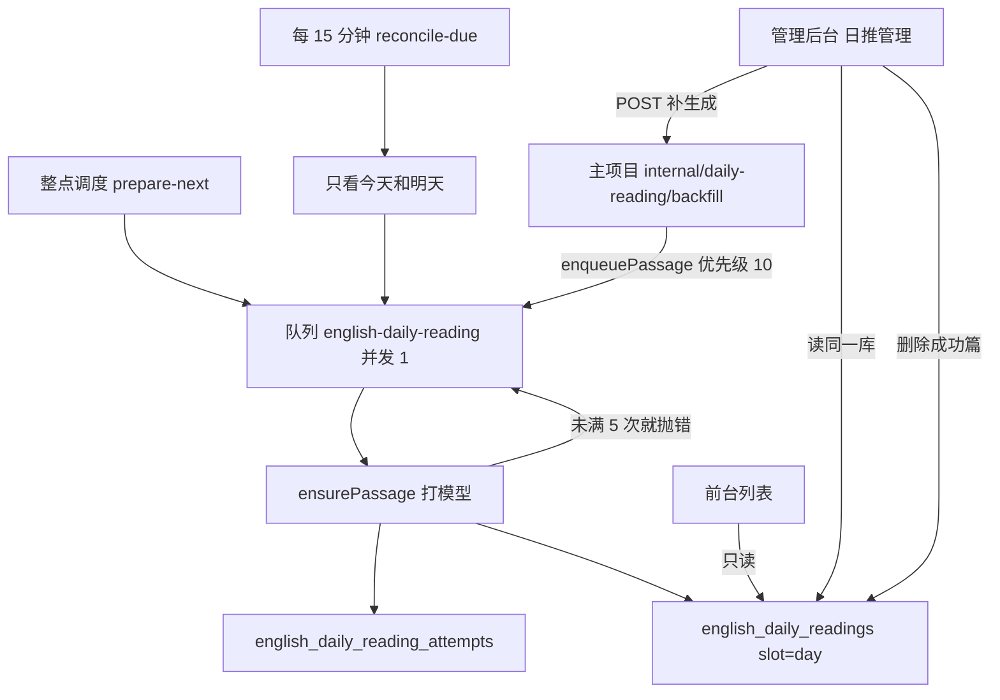

# 系统日推（功能实现详解与复刻指南）

> **一句话**：全站每天一篇英文短文由后台工人自己生成和重试，读者不能点重试；管理员在另一套后台里查看成功与失败，成功的可以删，失败的可以补进队列。  
> **入口**：前台「每日阅读」列表 `/english-learning/daily-reading`；管理后台侧栏「日推管理」`/ai-daily-reading`。  
> **关联文件**：主项目 `apps/backend/src/services/english-learning/english-daily-reading.service.ts`、`english-daily-reading.processor.ts`、`daily-reading-internal.controller.ts`、`apps/frontend/src/views/englishLearning/dailyReading/List.tsx`；管理项目 `dnhyxc-ai-admin` 的 `ai-daily-reading` 服务与两个页面。  
> **文档目标**：读懂「谁生成、谁重试、谁能删」；按复刻手册可在另一项目做出等价的定时短文加管理台。  
> **非目标**：自选生成（手动篇）、分享链接、朗读、设置页里改主题和档位的表单本身。那些仍走原来的手动接口，不进本篇的尝试表。

---

## 0. 先看这里

### 0.1 30 秒读懂

- **做什么**：到点生成明天的短文；失败最多自动再试 5 次；读者只看列表和「正在准备」；管理员看成功列表和缺口列表，成功可删，缺口可补进队列。
- **不做什么**：列表接口不打模型；补生成的 HTTP 请求也不打模型，只入队；历史缺口不会被 15 分钟任务自动全跑一遍。
- **关键角色**：前台列表只读状态；BullMQ 工人串行跑模型；尝试表记下每一轮；管理后台读同一张业务库，用内部密钥让主项目入队。

### 0.2 功能点总表

| 编号 | 功能点（人话） | 用户可感知表现 | 关键实现位置 | 正文小节 |
|------|----------------|----------------|--------------|----------|
| F1 | 打开系统日推列表不会触发模型 | 刷新列表不会突然多打一次模型 | `english-daily-reading.service.ts` → `list` | §4.1 |
| F2 | 今天还在准备时列表提示并隔几秒再问 | 空列表显示「正在准备」，约 40 秒内每 5 秒刷新 | `List.tsx` 轮询 effect | §4.2 |
| F3 | 五次都失败后只提示暂时没有 | 横幅文案，没有重试按钮 | `list` 的 `todayStatus` + `List.tsx` | §4.3 |
| F4 | 工人失败后隔 2 分钟再试，最多 5 次 | 读者无按钮；库里 `attempt_count` 增加 | `ensurePassage` / `giveUp` / `JOB_OPTS` | §4.4 |
| F5 | 每一轮工人跑完记一行 | 管理详情里能看到入队、耗时、token、成败 | `insertAttempt` / `nextAttemptNo` | §4.5 |
| F6 | 每 15 分钟只检查今天和明天 | 历史缺口不会被自动批量生成 | `registerReconcile` / `reconcileDue` | §4.6 |
| F7 | 管理后台用两个 tab 看成功和失败 | 「日推管理」里成功、失败各一张列表 | 管理端 `list` + `AiDailyReadingPage` | §4.7 |
| F8 | 失败日期可以立即补进队列 | 提示已入队；模型仍等工人空闲 | `backfill` → 主项目 `backfillDay` | §4.8 |
| F9 | 成功的短文可以删除 | 前台不再展示该日；失败列表出现「缺失」 | `removeReady` | §4.9 |
| F10 | 成功详情按前台版式看短文 | 点词释义、中文默认收起、题目标出「正确」且不能作答 | `PassageView` | §4.10 |
| F11 | 生成记录不用表格 | 与短文同宽的卡片，三列对齐 | `AttemptList` | §4.11 |
| F12 | 进入详情时用整页加载 | 与用户管理等页相同的「加载中...」，不先闪出「—」 | `noticeStore.setPageLoading` | §4.12 |

### 0.3 架构一图



### 0.4 文件地图与建造顺序

| 建造序 | 文件 | 职责 | 依赖 |
|--------|------|------|------|
| 1 | `daily-reading.constants.ts` | 队列名、冷却、5 次上限、补生成优先级 10 | 无 |
| 2 | `entity/english-daily-reading-attempt.entity.ts` | 一轮工人一行 | 1 |
| 3 | `migrations/1792900000000-english_daily_reading_attempts.ts` | 给日推行加次数和最后错误，并建尝试表 | 2 |
| 4 | `english-daily-reading.service.ts` | 入队、生成、记尝试、补漏、管理员补一天 | 1–3 |
| 5 | `english-daily-reading.processor.ts` | 区分补漏任务和生成任务 | 4 |
| 6 | `daily-reading-internal.controller.ts` | 用内部密钥接补生成，不走用户登录 | 4 |
| 7 | `apps/frontend/.../dailyReading/List.tsx` | 只展示状态，生成中短轮询，没有重试按钮 | 4 |
| 8 | 管理端 `ai-daily-reading.service.ts` | 缺口列表、成功列表、删除、转发补生成 | 3、6 |
| 9 | 管理端 `AiDailyReadingPage.tsx` / `AiDailyReadingDetailPage.tsx` | tab、详情版式、生成记录卡片、整页 Loading | 8 |

管理端代码在兄弟仓库 `dnhyxc-ai-admin`，连的是主项目同一套 MySQL，不是管理库。

---

## 1. 人话版：用户旅程

1. **进入**：读者打开每日阅读，看到已经写好的系统短文。今天如果还没有，页面说正在准备，并自己再问几次，没有「重试」按钮。
2. **主路径**：整点工人去写明天那篇。写坏了隔两分钟再写，一共最多五轮。写好后列表里出现这篇。
3. **分支**：五轮都失败，读者看到「今天的短文暂时没有」。管理员打开「日推管理」：成功 tab 点进去能读到和前台一样的短文，也能删掉；失败 tab 点进去能看到原因和每一轮记录，并点「立即补生成」。补生成只是排队，工人空出来才写。
4. **离开**：删掉成功篇后，前台当天不再展示；这一天回到失败列表的「缺失」，可以再补。

---

## 2. 问题与解决方案总表

| 问题编号 | 现象 / 风险 | 根因 | 解决方案 | 对应功能点 |
|----------|-------------|------|----------|------------|
| P1 | 很多人同时点重试，模型调用被打爆 | 列表刷新曾经顺手入队 | 列表只读；重试只在工人里 | F1、F3、F4 |
| P2 | 稿不合格却被队列当成成功，不再重试 | 软失败只改状态就 return | 未满 5 次时抛出已记过账的错误 | F4 |
| P3 | 新任务把次数从 1 再计，和旧行撞唯一索引 | 用队列的 `attemptsMade` 当序号 | 序号用该日 `MAX(attempt_no)+1` | F5 |
| P4 | 补历史把今天的整点任务堵住 | 队列默认同一优先级 | 自动任务优先级 0，补历史为 10 | F6、F8 |
| P5 | 管理员一点就在 HTTP 里打模型，请求超时 | 同步生成 | HTTP 只入队，5 秒连不上就报错 | F8 |
| P6 | 删了最早一天后，这一天从缺口里消失 | 缺口从库里最早一篇走到今天 | 删除中间日期会变成缺失；删掉最早一篇后下界前移，该日不再出现 | F7、F9 |
| P7 | 进详情先闪一根「—」 | 数据未到时用破折号占位 | 加载中不渲染占位符，改走整页 Loading | F12 |
| P8 | 系统篇主题每次看起来都一样 | 主题按日期哈希，不是每次抽签；档位只有设置成「随机」才抽 | 补生成与整点走同一条 `ensurePassage` | F4、F10 |

---

## 3. 实现思路总览

### 3.1 总体策略

生成和阅读拆开。阅读接口只查已经写好的行。生成全部进名为 `english-daily-reading` 的队列，工人并发为 1。失败不在接口里立刻再打模型，而是让队列按固定 2 分钟退避，最多 5 次。管理操作也不打模型：补生成是入队，删除是删行。

### 3.2 数据流与控制流

一天在 `english_daily_readings` 里用 `publish_date + slot=day` 唯一。`attempt_count` 是本轮预算，满 5 次工人直接返回。`english_daily_reading_attempts` 是历史，成功不把 `attempt_count` 清零，管理员再次补生成才把次数清零，尝试行保留到删除成功篇为止。

队列任务名：`prepare-next` 写明天；`prepare-date` 写指定日，`jobId` 就是日期；`reconcile-due` 不写文章，只决定要不要入队。

### 3.3 模块职责

`EnglishDailyReadingProcessor.process` 先看任务名。补漏交给 `reconcileDue`。其余把日期交给 `ensurePassage`。管理端 `AiDailyReadingService` 不持有队列，补生成时用环境变量里的地址和密钥请求主项目。

---

## 4. 分功能点详解

### 4.1 F1：打开列表不会触发模型

#### （1）人话说明

读者打开或下拉每日阅读，服务器只查已经写好的短文，并告诉前端今天是「好了 / 还在准备 / 五次用尽」。这次请求不会去叫模型。

#### （2）实现思路

以前列表在发现今天失败时会入队，很多人一起刷新就会排队打模型。现在入队只留在启动补今天、整点、15 分钟补漏和管理员补生成。

#### （3）问题与对策

对应 P1。没有今天这一行时状态仍是 `generating`，由补漏或整点去写，不由这次列表去写。

#### （4）实现过程

1. 查出今天 `slot=day` 的行。  
2. 按状态写成 `ready`、`exhausted` 或默认 `generating`。  
3. 列表查询再加 `status=ready`，半成品不会被当成一篇文章返回。

#### （5）关键代码

- **位置**：`apps/backend/src/services/english-learning/english-daily-reading.service.ts` → `list`
- **说明**：列表的唯一状态判断。没有 `enqueuePassage` 调用。

```ts
// 今天的日历日用上海时区，避免 UTC 把日期拨到昨天
const today = shanghaiToday();
// 只取系统槽位这一行，手动篇不参与「今天准备好了没有」
const todayRow = await this.repo.findOne({
	where: { publishDate: today, slot: DAY_SLOT },
});
// 缺行和未耗尽的失败都算还在准备，前端不要出现重试
let todayStatus: DailyReadingList['todayStatus'] = 'generating';
// 已经发布才对读者显示今天可用
if (todayRow?.status === 'ready') todayStatus = 'ready';
// 失败并且次数已到上限，才告诉前端不要再等
else if (
	todayRow?.status === 'failed' &&
	(todayRow.attemptCount ?? 0) >= MAX_ATTEMPTS
) {
	todayStatus = 'exhausted';
}
```

#### （6）复刻提示

- 可原样搬：列表函数里禁止调用入队。  
- 必须替换：时区函数、槽位字段名。  
- 最小验证：刷新列表时队列任务数不增加。

### 4.2 F2：今天还在准备时短轮询

#### （1）人话说明

系统日推列表如果今天还在准备，空的时候页面中间说正在准备；已经有旧文章时，顶上有一行同样的提示。每隔 5 秒再问一次，问满 8 次就停。

#### （2）实现思路

工人可能要一两分钟。短轮询比让用户手动刷新便宜，又比一直轮询省请求。次数写死在组件里，不另开长连接。

#### （3）问题与对策

切到「自选」或今天已经 `ready` / `exhausted` 时 effect 直接返回，避免空转。依赖里有 `load`，列表函数身份变化会重开计时器。

#### （4）实现过程

1. 仅当来源是系统日推且 `todayStatus===generating` 时启动定时器。  
2. 每 5 秒 `load(0, false)`。  
3. 计数超过 8 就清除定时器，不再请求。  
4. 卸载或状态变化时清定时器。

#### （5）关键代码

- **位置**：`apps/frontend/src/views/englishLearning/dailyReading/List.tsx`
- **说明**：8 次 × 5 秒，大约 40 秒后停止，不是一直等到生成结束。

```tsx
// 只有系统日推且今天仍在准备才轮询，自选列表不要打这个接口
useEffect(() => {
	if (origin !== 'day' || todayStatus !== 'generating') return;
	// 本次 effect 内的已刷新次数
	let n = 0;
	const timer = window.setInterval(() => {
		n += 1;
		// 第 9 次起不再请求，避免页面一直挂着刷新
		if (n > 8) {
			window.clearInterval(timer);
			return;
		}
		void load(0, false);
	}, 5000);
	return () => window.clearInterval(timer);
}, [origin, todayStatus, load]);
```

#### （6）复刻提示

- 可原样搬：条件 + 有限次 interval。  
- 必须替换：文案 key、`load` 的签名。  
- 最小验证：今天无文时出现准备提示，约 40 秒后网络面板不再出现列表请求。

### 4.3 F3：五次用尽后没有重试按钮

#### （1）人话说明

今天失败次数已经到顶时，列表上方有一句「今天的短文暂时没有」。旁边没有按钮。

#### （2）实现思路

人点的重试会绕过并发 1 的工人。用尽后的补救放到管理后台，并且要先把次数清零才能再入队（见 F8）。

#### （3）问题与对策

对应 P1。`failed` 且未满 5 次在 F1 里仍算 `generating`，所以横幅只在 `failed` 或 `exhausted` 时出现。当前 `list` 不会返回 `failed`，未耗尽的失败走「正在准备」。横幅条件保留 `failed`，避免以后状态字面值恢复时漏提示。

#### （4）实现过程

1. 接口把耗尽标成 `exhausted`。  
2. 页面在系统日推且状态为 `failed` 或 `exhausted` 时渲染横幅。  
3. 横幅只有文案，不绑定点击。

#### （5）关键代码

- **位置**：`List.tsx` 横幅
- **说明**：文案 key 为 `englishLearning.dailyReading.exhausted`。

```tsx
// 系统列表才谈「今天」；自选没有全站耗尽这回事
{origin === 'day' &&
(todayStatus === 'failed' || todayStatus === 'exhausted') ? (
	<div className="border-theme/10 bg-theme/5 mb-4 rounded-md border px-3 py-3 text-sm">
		{/* 只读说明，不提供重试，避免读者触发模型 */}
		<span>{t('englishLearning.dailyReading.exhausted')}</span>
	</div>
) : null}
```

#### （6）复刻提示

- 可原样搬：状态枚举驱动横幅，按钮不存在。  
- 最小验证：把该日 `attempt_count` 设为 5 且 `status=failed`，列表无按钮。

### 4.4 F4：工人失败后最多再试 5 次

#### （1）人话说明

写短文的人是队列工人，一次只干一件。稿不行或请求抛错时，如果还没到 5 次，任务失败，队列过 2 分钟再跑。到了 5 次就停，不再打模型。

#### （2）实现思路

BullMQ 只在任务抛错时按 `attempts` 重试。若失败只改数据库就正常返回，队列会当成成功。所以记完失败账之后，次数未满必须 `throw`。抛出的错误名叫 `AttemptRecorded`，外层 catch 不再记第二次。

主题用发布日哈希进主题列表，同一天再补一次主题不变。档位里标了 `random` 的字段，这一轮各抽一次；没标就用存好的具体值。系统档没存过时落到手动档，再空才是代码默认（B1、中篇、只读、不出题、允许联网）。

#### （3）问题与对策

对应 P2、P8。入队本身不带 delay，2 分钟只出现在失败之后的 backoff。`priority` 必须写在展开 `JOB_OPTS` 之后，否则会被默认盖掉。

#### （4）实现过程

1. 常量规定 5 次、固定退避 120 秒。  
2. `giveUp` 先 `recordFailure`，未满则抛 `AttemptRecorded`。  
3. 外层若已记过账，把原错误抛回队列。  
4. 满 5 次则 `giveUp` 不抛，任务结束。

#### （5）关键代码

- **位置**：同服务文件顶部 `JOB_OPTS`，以及 `ensurePassage` 内 `giveUp`
- **说明**：次数与队列 `attempts` 对齐，避免一边还想重试、另一边已经停手。

```ts
// 失败后的等待只在这里，第一次入队没有 delay
const JOB_OPTS = {
	attempts: 5,
	// 固定 2 分钟，不用指数退避，方便人对一下「下一轮何时开始」
	backoff: { type: 'fixed' as const, delay: 120_000 },
};
```

```ts
// 先落失败行和尝试行，再决定要不要让队列重试
const giveUp = async (reason: string) => {
	recorded = true;
	const next = await this.recordFailure(
		publishDate,
		reason,
		started,
		enqueuedAt,
		spent(),
	);
	// 还没花完 5 次才抛，抛了队列才会隔 2 分钟再调用本函数
	if (next < MAX_ATTEMPTS) {
		const err = new Error(reason);
		// 名字给外层 catch 看，避免同一轮失败记两行尝试
		err.name = 'AttemptRecorded';
		throw err;
	}
};
```

#### （6）复刻提示

- 可原样搬：先记账再按次数抛错。  
- 必须替换：队列库若没有固定退避，要自己写延迟任务。  
- 最小验证：故意让模型返回坏稿，库中 `attempt_count` 增加，2 分钟后工人日志再出现同一日期。

### 4.5 F5：每一轮记一行尝试

#### （1）人话说明

工人每跑完一轮（成功或失败）就在尝试表加一行：第几次、何时入队、何时开始结束、花了多少毫秒、多少 token、成败和原因。自选生成不写这张表。

#### （2）实现思路

日推行上的 `attempt_count` 会被管理员补生成清零，不能拿它当历史序号。队列换新任务后 `attemptsMade` 也会从 0 再计。序号用该日已有最大 `attempt_no` 加 1。

#### （3）问题与对策

对应 P3。写入失败只打日志，不让记历史的失败把已经生成好的文章打回失败。

#### （4）实现过程

1. 查该日 `MAX(attempt_no)`。  
2. 插入一行，入队时间缺省时用开始时间。  
3. 唯一索引 `(publish_date, attempt_no)` 挡住并发双插。

#### （5）关键代码

- **位置**：`nextAttemptNo`、`insertAttempt`
- **说明**：展示用的「第几次」和预算用的 `attempt_count` 不是同一个数。

```ts
// 不用队列 attemptsMade，新 job 会从 0 计数并撞上旧序号
private async nextAttemptNo(publishDate: string): Promise<number> {
	const raw = await this.attempts
		.createQueryBuilder('row')
		.select('COALESCE(MAX(row.attemptNo), 0)', 'max')
		.where('row.publishDate = :publishDate', { publishDate })
		.getRawOne<{ max: string | number | null }>();
	// 空表得到 1
	return Number(raw?.max ?? 0) + 1;
}
```

#### （6）复刻提示

- 可原样搬：最大序号加 1，而不是「本轮第几次」。  
- 最小验证：同一天失败两次再成功，三行的 `attempt_no` 为 1、2、3。

### 4.6 F6：每 15 分钟只补今天和明天

#### （1）人话说明

进程启动时除了整点任务，还登记一个每 15 分钟跑一次的任务。它只看今天和明天：已经写好，或失败次数已满，就跳过；否则入队。更早的缺口不会被它自动生成。

#### （2）实现思路

历史缺口可能很多。若 15 分钟任务把缺口全塞进队列，会挡住今天。历史交给管理员按天点。自动任务优先级为 0，管理员补的历史是 10，数字小的先跑。正在跑的那一篇不会被抢走。

#### （3）问题与对策

对应 P4。处理器必须先识别任务名 `reconcile-due`。若把它当成普通生成任务，空数据会被写成「明天」。

#### （4）实现过程

1. `upsertJobScheduler` 使用固定 id `daily-reading-reconcile`。  
2. 工人见到该名字只调用 `reconcileDue`。  
3. `reconcileDue` 对今天、明天各查一行再决定入队。

#### （5）关键代码

- **位置**：`english-daily-reading.processor.ts` → `process`；服务里 `reconcileDue`

```ts
// 补漏任务没有 publishDate，不能落到「生成明天」那条分支
if (job.name === 'reconcile-due') {
	await this.dailyReading.reconcileDue();
	return;
}
// 整点任务名为 prepare-next，日期在这里算成上海的明天
const publishDate =
	job.name === 'prepare-next' || !job.data?.publishDate
		? addCalendarDays(shanghaiToday(), 1)
		: job.data.publishDate;
```

```ts
// 只这两天，不要从最早一篇扫到今天
const dates = [shanghaiToday(), addCalendarDays(shanghaiToday(), 1)];
for (const date of dates) {
	const row = await this.repo.findOne({
		where: { publishDate: date, slot: DAY_SLOT },
	});
	// 写好了或五次用尽都不再自动入队
	if (row?.status === 'ready' || (row.attemptCount ?? 0) >= MAX_ATTEMPTS) {
		continue;
	}
	await this.enqueuePassage(date);
}
```

#### （6）复刻提示

- 可原样搬：调度任务名与生成任务名分开。  
- 最小验证：库里缺一个上周的日期，15 分钟后队列里没有该日期。

### 4.7 F7：管理后台用 tab 分开成功和失败

#### （1）人话说明

超级管理员侧栏是「日推管理」。默认打开成功：已经写好的系统短文，按日期从新到旧。失败 tab 从库里最早一篇走到今天，跳过已经成功的日子，剩下的标成缺失、生成中、已耗尽或失败。

#### （2）实现思路

管理端 `synchronize` 关闭，实体只映射要用的列，连主项目业务库。列表接口 `GET /ai-daily-reading?kind=ready|gap`。不传 `kind` 时仍是缺口列表。

#### （3）问题与对策

对应 P6。没有「系统从哪一天开始」的单独配置，缺口下界是当前最早一行。成功列表不走这套下界，凡 `status=ready` 且 `slot=day` 都列出。

#### （4）实现过程

1. 页面用查询参数 `tab=ready|gap`，缺省为成功。  
2. 请求带 `kind`。  
3. 点行进入 `/ai-daily-reading/:publishDate?tab=`，返回时回到同一个 tab。  
4. 成功行有删除；失败行没有。

#### （5）关键代码

- **位置**：管理端 `ai-daily-reading.controller.ts` → `list`；`ai-daily-reading.service.ts` → `listGaps` 末尾过滤

```ts
// ready 走成功列表，其它值保持旧行为：只给缺口
@Get()
list(@Query('kind') kind?: string) {
	return kind === 'ready'
		? this.dailyReading.listReady()
		: this.dailyReading.listGaps();
}
```

```ts
// 成功的日子不出现在失败 tab，避免两处重复管理
.filter((row) => row.status !== 'ready')
.reverse();
```

#### （6）复刻提示

- 可原样搬：一个列表接口用 query 分流。  
- 必须替换：菜单文案、角色守卫。本项目接口带 `@Roles(Role.ADMIN)`。  
- 最小验证：成功 tab 行数等于 `slot=day AND status=ready` 的行数。

### 4.8 F8：失败日期立即补进队列

#### （1）人话说明

在失败详情点「立即补生成」，管理后台请求主项目的内部接口。主项目检查日期、是否已写好、是否正在跑、是否还在冷却。通过后把这一天放进队列，优先级低于今天和明天的自动任务。页面提示已入队。

#### （2）实现思路

模型调用可能超过网关超时，所以 HTTP 在 5 秒内只做入队。两边用同一把 `DAILY_READING_INTERNAL_TOKEN`，请求头 `x-internal-token`。空密钥谁也不放行。比较用定长 `timingSafeEqual`。

未来日期直接 `{ ok:false, reason:'future' }`，用来探测密钥是否生效且不入队。

#### （3）问题与对策

对应 P5。管理端把主项目 401 说成密钥不一致或主项目未重启，把连不上说成带上基址的 502。基址不要带 `/api`，代码会自己拼 `/api/internal/daily-reading/backfill`。同机应填 `http://127.0.0.1:<主项目端口>`。

次数已满时先 `resetAttempts`：`attempt_count` 归零，并把 `started_at` 拨出 5 秒冷却。尝试行不删。

#### （4）实现过程

1. 管理端 `POST /ai-daily-reading/:publishDate/backfill`。  
2. 转发到主项目内部接口。  
3. `backfillDay` 拒绝未来、已完成、未过期的 pending、未耗尽且仍在冷却的失败。  
4. `enqueuePassage` 使用 `jobId=日期` 和 `priority=10`。

#### （5）关键代码

- **位置**：`daily-reading-internal.controller.ts`；`backfillDay` 的次数重置与入队

```ts
// 没配置密钥或没带头，一律拒绝，避免空字符串被当成通过
if (!tokenOk(token, process.env.DAILY_READING_INTERNAL_TOKEN)) {
	throw new UnauthorizedException();
}
// 真正的判断和入队都在服务里，控制器不碰模型
return this.dailyReading.backfillDay(body?.publishDate ?? '');
```

```ts
// 五次用尽后管理员这下是新的一轮预算，历史尝试行仍留着
if (row && (row.attemptCount ?? 0) >= MAX_ATTEMPTS) {
	await this.resetAttempts(publishDate);
}
// 10 比自动任务的 0 大，今天和明天还没开始跑时可以插到历史补篇前面
await this.enqueuePassage(publishDate, { priority: BACKFILL_PRIORITY });
```

#### （6）复刻提示

- 可原样搬：内部接口与用户 JWT 分离；入队与生成分离。  
- 必须替换：基址、密钥放在两边的环境变量，文档和仓库都不要写真实值。  
- 最小验证：用明天以后的日期调用，返回 `future` 且队列无新任务；用今天的缺口调用，队列出现该 `jobId`。

### 4.9 F9：成功的短文可以删除

#### （1）人话说明

成功列表和成功详情都能删。确认后这一天的系统短文和它的尝试记录一起删掉。前台不再展示。失败列表里，如果它不是最早的下界，会显示为「缺失」。

#### （2）实现思路

只允许删 `slot=day` 且 `status=ready` 的行。手动篇槽位不是 `day`，不会被这次删除带走。先删尝试再删日推行，避免留下孤儿序号。

#### （3）问题与对策

对应 P6。缺口算法依赖「最早一行」。删掉当前最早的成功篇后，下界变成剩下的最早日期，被删的那一天不会出现在失败列表。删中间的一天则会变成缺失，可以再补。

#### （4）实现过程

1. 校验 `YYYY-MM-DD`。  
2. 找不到行返回 404；不是成功返回 400。  
3. 按日期删尝试，再按主键删日推行。  
4. 前端成功后回到成功 tab。

#### （5）关键代码

- **位置**：管理端 `removeReady`

```ts
// 只删已发布的系统篇，失败篇留在缺口里给补生成
if (row.status !== 'ready') {
	throw new BadRequestException('只能删除已生成成功的日推');
}
// 尝试表没有外键，要显式删，否则同一天再生成会从旧序号往后计
await this.attempts.delete({ publishDate });
await this.days.delete({ id: row.id });
```

#### （6）复刻提示

- 可原样搬：先子表后主表，且限制状态。  
- 最小验证：删一个中间日期后，失败 tab 该日为「缺失」，前台列表没有该日。

### 4.10 F10：成功详情按前台版式看短文

#### （1）人话说明

成功详情先是一篇短文：英文标题，下面是日期、系统日推、难度、篇幅、侧重点和题数。正文里的词可以点开看中文。中文译文默认收着。接着是参考来源、词汇卡片、语法卡片。理解题的正确选项标着「正确」，不能点、不能提交。生成记录在短文下面。

#### （2）实现思路

管理端详情在 `status===ready` 时多返回 `passage`（标题、正文、来源、`extras` JSON）。版式对齐前台 `Detail.tsx`：逐词释义按句子嵌回段落，而不是另开一张词表。题目用前台答对后的青色底，并写上「正确」，因为这里没有作答过程。

#### （3）问题与对策

对应 P8。这里展示的就是该次 `resolveProfile` 和 `themeForDate` 写进库的结果，不会在打开详情时再随机一次。

`extras.sources` 优先；没有则退回单条 `sourceUrl`。语法兼容旧的单条 `grammarNote` 和新的 `grammarNotes`。

#### （4）实现过程

1. 管理实体补上正文、来源和 `extras` 列，只读不建表。  
2. `getDay` 在成功时带上 `passage`。  
3. 页面用与前台相同的段落对齐算法把 `wordGloss` 嵌进英文。  
4. 中文用本地状态切换，默认关。  
5. 正确选项不可点击。

#### （5）关键代码

- **位置**：管理端 `AiDailyReadingDetailPage.tsx` → 题目块
- **说明**：选项是 `div` 不是按钮，所以不能作答。

```tsx
// 下标等于答案的那一项才标正确，其它项只是同一张卡片样式
const right = optionIndex === item.answer;
return (
	<div
		key={option}
		className={
			right
				? 'flex min-h-11 w-full items-center rounded-md border border-teal-500/40 bg-teal-500/15 px-3.5 py-2.5 text-left text-lg leading-snug'
				: `flex min-h-11 w-full items-center ${CARD} text-left text-lg leading-snug`
		}
	>
		{right ? (
			<span className="mr-2 shrink-0 text-base text-teal-500">正确</span>
		) : null}
		{option}
	</div>
);
```

#### （6）复刻提示

- 可原样搬：详情读已落库的 `extras`，不要现场再生成。  
- 必须替换：若前台释义交互不同，嵌句算法要和前台用同一份。  
- 最小验证：打开一篇有词汇和题目的成功日，中文默认不可见，正确选项带「正确」。

### 4.11 F11：生成记录用卡片而不是表格

#### （1）人话说明

每一轮是一块卡片，标题左是「第 N 次」，右是成功或失败。下面三列：第一行入队、开始、结束；第二行生成时间和 token。字号与短文说明一样。失败才多一行原因。没有记录时写「尚未生成」。

#### （2）实现思路

表格和上面的窄栏短文宽度、字号都不一致。卡片放在同一个 `max-w-2xl` 里。时间格式与前台生成信息一样，用 `分:秒`，满小时再加小时。

#### （3）问题与对策

无独立故障。注意：生成时间是开始到结束的毫秒，不是队列退避的 2 分钟。

#### （4）实现过程

1. 把五个字段放进网格，每格上标签下数值。  
2. 成功用青色，失败用玫瑰色。  
3. `reason` 为空不渲染。

#### （5）关键代码

- **位置**：`AttemptList` 中的字段网格
- **说明**：三列网格让短的 token 不会单独掉成难看的一行。

```tsx
// 五个字段按行填充，第三列在第二行留空，对齐比硬换行稳
<div className="grid grid-cols-3 gap-x-4 gap-y-3">
	{fields.map(([label, value]) => (
		<div key={label} className="min-w-0">
			<div className="text-sm leading-7 opacity-80">{label}</div>
			<div className="text-sm leading-7 tabular-nums">{value}</div>
		</div>
	))}
</div>
```

#### （6）复刻提示

- 可原样搬：记录区宽度与正文容器相同。  
- 最小验证：一条成功记录没有「原因」行，时间是 `mm:ss` 而不是「多少秒」。

### 4.12 F12：进入详情时用整页 Loading

#### （1）人话说明

点进某一天，在数据回来之前，页面用和其他管理页一样的整页「加载中...」。不会先闪出一根破折号，也不会先闪出「尚未生成」。

#### （2）实现思路

管理布局在 `noticeStore.pageLoading` 时盖一层 `Loading`（`size={75}`，文案「加载中...」）。用户、知识库等列表已经这么做。详情若自己放一个转圈，和全站不一致。数据未到时也不要写占位符「—」。

#### （3）问题与对策

对应 P7。本地 `loading` 仍保留，用来在首屏还没盖上遮罩时不渲染空的「尚未生成」，以及禁用补生成按钮。离开页面时把遮罩关掉，避免请求未完成就切走后遮罩粘住。

再次加载（补生成后刷新）时已有详情，不把正文卸掉，只盖遮罩。

#### （4）实现过程

1. `load` 开始 `setPageLoading(true)`，结束设回 false。  
2. effect 清理函数同样设回 false。  
3. `loading && !detail` 时正文渲染 `null`。  
4. 失败原因只在已有详情、不是成功、且 `lastError` 非空时显示。

#### （5）关键代码

- **位置**：`AiDailyReadingDetailPage` 的 `load`；布局在 `AdminLayout.tsx` 已有遮罩，详情不重复画组件

```ts
// 与用户管理等页同一开关，遮罩由布局统一画
noticeStore.setPageLoading(true);
getAiDailyReadingApi(publishDate)
	.then((res) => setDetail(res.data as Detail))
	.catch(() => setDetail(null))
	.finally(() => {
		setLoading(false);
		// 成功失败都要关掉，否则整站一直盖着加载层
		noticeStore.setPageLoading(false);
	});
```

#### （6）复刻提示

- 可原样搬：页面级加载用全局 store，不在每个页面内嵌一套转圈。  
- 必须替换：若新项目没有 `noticeStore`，就用那套项目唯一的页面 Loading。  
- 最小验证：慢网打开详情，先看到「加载中...」，没有单独的 antd Spin，也没有「—」。

---

## 5. 跨项目复刻手册

### 5.1 前置条件

- 一个队列（本项目是 BullMQ）且工人可以抛错触发重试。  
- 业务表能表达「一天一行」和「一轮一行」。  
- 管理端能连同一数据库，或改为只通过内部 HTTP 读，不要两套生成逻辑。  
- 内部补生成需要共享密钥和主服务基址，两边进程都要在写入环境变量后重启。  
- 管理接口需要管理员角色。

### 5.2 推荐建造顺序

1. **Step 1 — 表**：日推行加 `attempt_count`、`last_error`；新建尝试表，唯一 `(publish_date, attempt_no)`。验收：迁移可重复执行策略与项目一致，空库能插入第一行。  
2. **Step 2 — 入队**：`jobId=日期`，已完成、未过期 pending、冷却中的失败不再入队。验收：同一天连调两次只有一个等待任务。  
3. **Step 3 — 工人**：失败记账后未满 5 次抛错；满 5 次不抛。验收：坏稿会隔退避时间再跑。  
4. **Step 4 — 列表只读**：返回今天三态，且函数内无入队。验收：刷新不增加队列任务。  
5. **Step 5 — 前台**：去掉重试；生成中有限次轮询；耗尽只显示文案。验收：F2、F3。  
6. **Step 6 — 15 分钟补漏**：只今天和明天，任务名单独分支。验收：F6。  
7. **Step 7 — 内部补生成**：密钥、未来日期拒绝、耗尽后清次数再入队、优先级低于自动任务。验收：F8。  
8. **Step 8 — 管理列表与删除**：成功 / 缺口、删除只限已发布系统篇。验收：F7、F9。  
9. **Step 9 — 详情**：短文版式、题目只标正确、生成记录卡片、整页 Loading。验收：F10–F12。

### 5.3 最小可运行切片

先做 F1、F4、F5：列表不打模型，工人会重试并记下尝试。  
然后 F2、F3 让读者侧完整。  
F6–F9 是管理侧主路径。  
F10–F12 是详情体验，可后做，不影响生成正确性。

### 5.4 平台差异清单

| 本项目用法 | 可移植抽象 | 其他项目常见替身 |
|------------|------------|------------------|
| BullMQ `attempts` + `backoff.fixed` | 失败后延迟再执行，有上限 | 自建延迟队列、云任务的 retry 配置 |
| `jobId = 发布日` | 同一天最多一个未完成任务 | 数据库唯一约束加「入队中」状态 |
| `priority` 0 与 10 | 自动任务优先于人工补历史 | 两个队列，自动队列先消费 |
| `noticeStore.pageLoading` + `Loading` | 全站唯一的页面加载层 | 路由级 Suspense、布局里的一个 spinner |
| 管理端 `fetch` 主项目 | 跨进程入队，HTTP 不跑模型 | 管理端直接往同一 Redis 入队（需共享队列权限） |
| antd 页面里的短文用普通 div | 详情只读展示已存 JSON | 任何组件库，只要不把题目做成可提交表单 |

### 5.5 验收用例

- [ ] F1：打开系统列表，队列任务数不变。  
- [ ] F2：今天无文时出现准备提示，约 40 秒后停止自动刷新。  
- [ ] F3：耗尽时只有文案，没有重试。  
- [ ] F4：坏稿后 `attempt_count` 增加，未满 5 次会再跑。  
- [ ] F5：每轮尝试表一行，序号连续，自选生成不增加行。  
- [ ] F6：上周缺口不会在 15 分钟内自动入队；今天缺了会入队。  
- [ ] F7：成功 tab 与失败 tab 不重复同一天。  
- [ ] F8：补生成返回已入队；用未来日期返回 future 且不入队；密钥错误为拒绝。  
- [ ] F9：删除成功篇后前台消失；非最早日期出现在失败列表。  
- [ ] F10：中文默认收起；正确选项有「正确」且点不动。  
- [ ] F11：生成记录是卡片不是表。  
- [ ] F12：进入详情先整页「加载中...」，没有「—」。  
- [ ] 回归：自选生成、设置页保存、已发布短文的阅读页仍可用。

### 5.6 常见移植失误

- 软失败不抛错，队列不再重试，读者一直看到准备中直到次数其实没涨。  
- 用 `attemptsMade + 1` 当尝试序号，补生成新任务会和旧行冲突。  
- 内部接口挂了用户登录守卫，管理端转发没有用户票，永远 401。  
- 基址写成了带 `/api` 的地址，代码再拼一次变成 `/api/api/...`。  
- 密钥只写在仓库的 env 文件，线上进程没重启，探测一直 401。  
- 15 分钟任务没单独分支，被当成「生成明天」。  
- 删除只删日推行，尝试表旧序号还在，下一次从较大的号开始，管理界面看起来像跳号。  
- 详情加载用破折号占位，慢请求时读者以为出错。

---

## 6. 验证要点

- [ ] 主路径：整点或补漏后，一篇短文变为 ready，前台能打开。  
- [ ] 边界：同一天重复补生成被 `jobId` 挡住；已完成再补返回已生成。  
- [ ] 失败：第五次后工人不再打模型；管理端仍可清次数再入队。  
- [ ] 与自选并存：手动篇 `slot` 不是 `day`，不进失败列表，也不能被日推删除。

---

## 7. 影响与边界

### 7.1 对本项目其他功能的影响

- **是否影响已有功能点**：局部。系统日推列表不再入队；自选生成、设置保存、阅读详情接口仍走原路径。  
- **是否影响既有正常逻辑**：局部。`list` 的 `todayStatus` 增加耗尽语义；前台去掉了重试按钮。已发布短文的字段没有改含义。

### 7.2 影响点明细

| # | 对象 | 方式 | 程度 | 说明与回归 |
|---|------|------|------|------------|
| 1 | 前台每日阅读列表 | 不再入队；耗尽文案；有限轮询 | 高 | 刷新不应打模型；准备中约 40 秒内会再请求 |
| 2 | 队列工人 | 软失败改为抛错；补漏任务名分支 | 高 | 坏稿会重试；`reconcile-due` 不会生成一篇多余的明天 |
| 3 | 日推行 | 多了次数和最后错误 | 中 | 旧行默认次数 0，已发布的仍是 ready |
| 4 | 尝试表 | 新表 | 中 | 自选生成不写 |
| 5 | 管理后台 | 新菜单与接口 | 中 | 仅管理员；读业务库 |
| 6 | 内部 HTTP | 新路由，密钥 | 中 | 未配置密钥时一律拒绝 |

### 7.3 文档范围外的相邻能力

自选生成的流式输出、设置页保存主题和档位、前台短文朗读、分享链接，都不在本篇。系统篇的主题按日期哈希、档位仅在设置为随机时抽取，这是生成时的既有规则，详情只展示已经写进库的结果。
